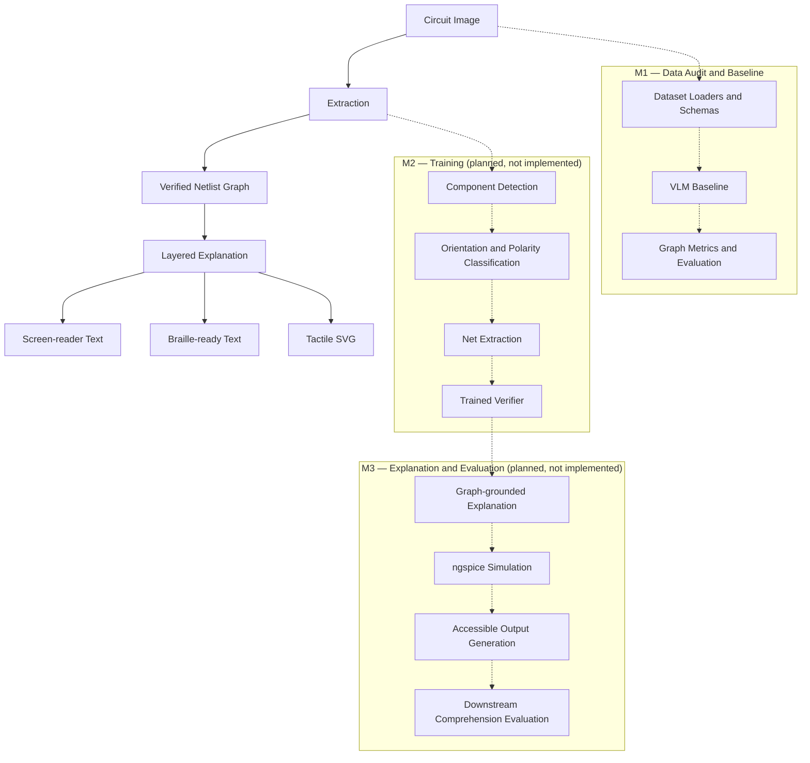

# Verified Circuit Access

**Making circuit diagrams accessible to blind students through verified, structured representations.**

## 1. Problem Statement

Circuit diagrams are widely used in high-school and undergraduate science and engineering education. However, these diagrams are primarily visual. Blind and visually impaired students may therefore be unable to independently identify electronic components, understand their connections, and follow the circuit's overall structure.

Existing text-to-speech and screen-reader tools cannot directly communicate the spatial and electrical relationships represented in a circuit diagram.

**Verified Circuit Access** aims to address this accessibility gap by converting circuit images into structured, verified representations that can eventually be communicated through screen readers, Braille displays, and tactile diagrams.

The central idea is to avoid presenting extracted circuit information as automatically correct. A verification layer is planned to identify potentially incorrect components and connections before explanations are generated.

## 2. Project Architecture

The planned system follows this pipeline:



### Milestones

**M1 — Data Audit and Baseline**

The current milestone establishes the dataset audit, common annotation and netlist schemas, dataset loaders, evaluation metrics, and a pluggable Vision-Language Model (VLM) baseline interface.

A VLM is a model capable of processing visual inputs and producing structured textual outputs.

**M2 — Training (planned, not implemented)**

- Component detection using a YOLO-family detector.
- Orientation, polarity, and crossing-versus-junction classification.
- Electrical net extraction.
- A trained verifier using gradient boosting and calibration.

**M3 — Explanation and Evaluation (planned, not implemented)**

- Layered explanations generated from verified circuit graphs.
- Numeric electrical facts grounded in ngspice simulation.
- Screen-reader text, Braille-ready output using liblouis, and tactile-printable SVG.
- Downstream comprehension evaluation.

## 3. Current M1 Implementation

| Module | Current functionality |
|---|---|
| Schemas | Pydantic annotation, netlist, and taxonomy schemas |
| Data | Image2Net Labelme, YOLO OBB, and validation-netlist loaders |
| CGHD | Gated dataset loader stubs |
| Metrics | Graph isomorphism and component/connection precision and recall |
| NED | Deliberately unimplemented pending verification |
| VLM baseline | Provider interface, JSON validation, retries, and error handling |
| Evaluation | Approval checks, circuit comparison, manifests, and results storage |
| Overlays | Ground-truth bounding-box visualization and explanatory legends |

The current evaluation framework does not produce component localization or independent connection precision/recall results from netlist-only VLM predictions. These values remain unavailable rather than being inferred.

## 4. Technology Stack

- **Python 3.11** — primary implementation language.
- **Pydantic** — structured data validation.
- **NetworkX** — graph construction and isomorphism.
- **SciPy** — Hungarian assignment for component matching.
- **Pillow** — evaluation overlays.
- **pytest** — automated testing.
- **Hypothesis** — property-based testing.
- **Ruff** — linting.
- **uv** — dependency and environment management.

## 5. Setup and Reproduction

### Prerequisites

- Python 3.11
- pip
- Git
- Linux, macOS, or another compatible Python environment

### Step 1: Clone the repository

```bash
git clone <repository-url>
cd verified-circuit-access
```

### Step 2: Create and activate a virtual environment

```bash
python3.11 -m venv .venv
source .venv/bin/activate
```

On Windows:

```powershell
.venv\Scripts\activate
```

### Step 3: Install the project and development dependencies

```bash
pip install -e ".[dev]"
```

The development dependencies include pytest, Hypothesis, and Ruff.

Alternatively, using the existing uv lockfile:

```bash
uv sync --locked
```

### Step 4: Configure environment variables if required

Copy the example environment file only when configuring a provider that needs credentials:

```bash
cp .env.example .env
```

The current `.env.example` contains comments only. No real provider or API credential has been configured.

**Never commit real API keys, passwords, or other credentials to Git.** Store credentials in environment variables and keep `.env` out of version control.

### Step 5: Dataset preparation and approval

Before using any dataset, review `DATASETS.md` and resolve its licensing and access requirements.

The current `make data` target is a placeholder. It prints a licensing reminder and exits with an error. An interactive dataset approval and download workflow has not yet been implemented.

No dataset files are included in the repository.

### Step 6: Evaluation

The intended command is:

```bash
make eval
```

However, this target is currently a placeholder and exits without running an evaluation.

The Python evaluation framework requires separate explicit dataset and VLM approvals through `data_approved=True` and `vlm_approved=True`. These approvals do not override unresolved dataset licensing restrictions.

No real VLM API calls or full evaluation runs have been performed.

**API cost:** A reliable per-run estimate is not currently available because no provider or model has been selected and no full evaluation run is configured. Once selected, the estimated cost can be calculated using the provider's current input/output pricing, image-token usage, expected retries, and number of evaluation circuits. No API cost is claimed for the current implementation.

### Step 7: Demo

```bash
make demo
```

The demo target is currently a placeholder and exits without launching an application.

### Step 8: Run tests and lint

Run the full test suite:

```bash
pytest
```

Run lint checks:

```bash
ruff check .
```

## 6. Dataset Approval Status

Dataset approval is tracked separately from implementation. No dataset files have been downloaded or included in the repository.

| Dataset | Status | Reason |
|---|---|---|
| Image2Net (`ci2n_datasets`) | Pending approval | Repository code and material have an Apache-2.0 license, but the original-source data licensing caveat requires explicit approval. |
| CGHD | Pending approval | Conflicting license information across sources; the actual Zenodo release license remains unresolved. |
| AMSnet 2.0 | Pending approval | License and confirmed public access or distribution are unverified. |
| Masala-CHAI | Pending approval | License and distribution source are unclear. Weak labels only; never for evaluation. |
| SINA | Pending approval | Explicit license and dataset distribution source remain unverified. |
| CircuitReason-1k | Pending approval | No repository license; benchmark images are not bundled and depend on source materials with appropriate usage rights. |

Refer to `DATASETS.md` for the detailed source, license, format, size, intended use, and risk audit.

## 7. Evaluation Metrics

The following metrics are part of the M1 evaluation design.

| Metric | Value range | Passing threshold | Current result |
|---|---|---|---|
| Normalized Edit Distance (NED) | not run | not run | not run |
| Graph-isomorphism accuracy | not run | not run | not run |
| Component precision | not run | not run | not run |
| Component recall | not run | not run | not run |
| Connection precision | not run | not run | not run |
| Connection recall | not run | not run | not run |

Numeric cells are marked `not run` because no real-data evaluation results have been produced. Passing thresholds have not yet been established.

### Metric definitions

- **Normalized Edit Distance:** Measures the normalized graph-edit difference between a predicted and ground-truth circuit netlist. Its implementation remains gated pending verification of the reference formula and edge cases.
- **Graph-isomorphism accuracy:** Measures whether predicted and ground-truth circuit graphs have equivalent topology, considering canonical component categories and terminal connections.
- **Component precision:** Measures the proportion of predicted components that match ground-truth components.
- **Component recall:** Measures the proportion of ground-truth components successfully matched.
- **Connection precision:** Measures the proportion of predicted connections that match ground-truth connections.
- **Connection recall:** Measures the proportion of ground-truth connections successfully recovered.

Component matching currently uses Hungarian assignment, canonical categories, and a provisional centre-distance threshold of 10 pixels. This is a matching parameter, not an experimentally established passing threshold.

Connection matching currently depends on full graph isomorphism for component correspondence. Consequently, it cannot independently quantify connection errors when the graphs are not isomorphic.

## 8. Project Structure

```text
verified-circuit-access/
├── DATASETS.md
├── PLAN.md
├── README.md
├── Makefile
├── pyproject.toml
├── uv.lock
├── .env.example
├── src/
│   └── vca/
│       ├── schemas/
│       ├── data/
│       ├── metrics/
│       ├── baseline/
│       ├── detect/
│       ├── classify/
│       ├── netting/
│       ├── verify/
│       ├── explain/
│       └── outputs/
└── tests/
    ├── schemas/
    ├── data/
    ├── metrics/
    └── baseline/
```

Dataset files and generated evaluation results are excluded from version control according to `.gitignore`.

## 9. Reproducibility and Project Rules

- Use Python 3.11 and pinned dependencies.
- Use real datasets only after explicit approval.
- Never generate synthetic training or evaluation images or labels.
- Do not commit dataset images, copyrighted textbook material, API credentials, or generated evaluation results.
- Record configuration, random seed, and Git commit hash for actual evaluation runs.
- Report uncomputed metrics as `not run`.
- Keep M2 and M3 functionality separate from the M1 implementation until those milestones are approved.

## 10. Project Status

**Current milestone: M1 — Data Audit and Baseline**

The repository contains the M1 schemas, loaders, metrics, VLM interface, evaluation framework, and automated tests.

Dataset usage and real VLM evaluation remain subject to explicit approval. NED computation remains intentionally gated. The M2 training pipeline and M3 explanation and accessibility outputs are planned but not implemented.

See `PLAN.md` for the complete milestone plan and `DATASETS.md` for dataset approval details.
