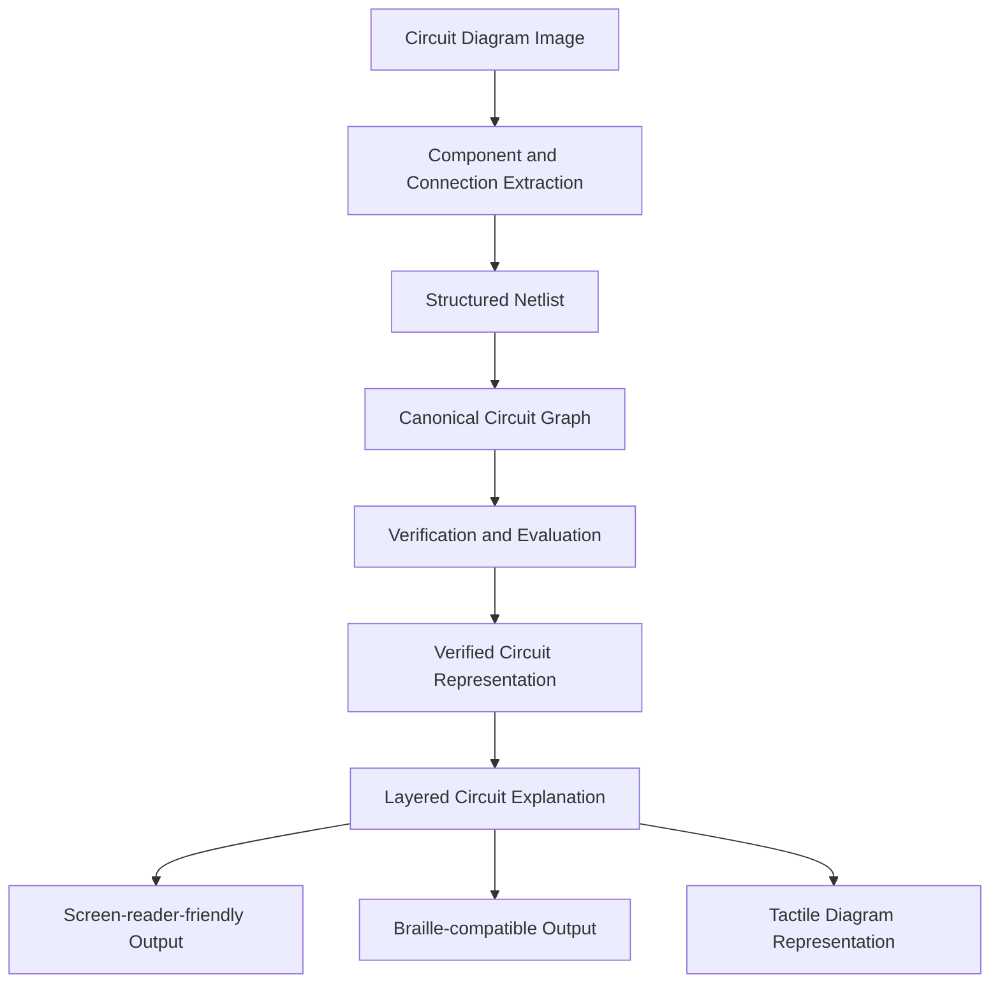

# VERIFIED-CIRCUIT-ACCESS

**Verified circuit diagram understanding and accessible explanations for blind and visually impaired students.**

VERIFIED-CIRCUIT-ACCESS is a system designed to convert circuit diagram images into structured, verified electrical representations and accessible explanations. It aims to make circuit diagrams easier to understand through screen-reader-friendly descriptions and other accessible representations.

## 1. Project overview

Circuit diagrams contain visual information such as components, terminals, wires, connections, labels, and electrical relationships. For blind and visually impaired students, understanding these diagrams can be difficult because conventional learning materials rely heavily on visual interpretation.

This project aims to bridge that gap by developing a pipeline that:

1. Extracts circuit components and connections from circuit diagram images.
2. Represents the extracted circuit as a structured netlist graph.
3. Evaluates the correctness of the extracted representation.
4. Uses verified graph information to generate circuit explanations.
5. Supports accessible output formats such as screen-reader-friendly text, Braille-compatible descriptions, and tactile diagram representations.

The project prioritizes verification and traceability rather than relying solely on generated explanations.

## 2. System architecture



The intended architecture separates extraction, graph representation, verification, and explanation. This allows the correctness of the underlying circuit representation to be evaluated independently of the generated explanation.

## 3. Main objectives

- Develop structured schemas for circuit annotations, components, terminals, and electrical connections.
- Integrate circuit diagram datasets with documented licensing and access conditions.
- Convert netlists into canonical graph representations.
- Evaluate extracted circuits using graph-based metrics.
- Establish a baseline interface for vision-language model predictions.
- Identify potentially incorrect extractions for review.
- Ensure numerical explanations are grounded in circuit simulation results.
- Develop accessible representations suitable for blind and visually impaired students.

## 4. Repository status

The repository currently contains the foundational implementation for Milestone 1 (M1).

| Component | Current status |
|---|---|
| Project configuration and development setup | Implemented |
| Annotation schema | Implemented |
| Netlist schema | Implemented |
| Component taxonomy | Implemented |
| Image2Net dataset integration | Implemented |
| Dataset taxonomy audit | Implemented |
| CGHD dataset integration | Gated stub |
| Graph isomorphism metric | Implemented |
| Normalized graph edit distance (NED) | Implemented |
| VLM baseline interface | Implemented |
| Evaluation framework | Implemented |
| Evaluation overlays | Implemented |
| Results storage | Implemented |
| Trained component verifier | Not implemented |
| ngspice-based numerical verification | Not implemented |
| Accessible explanation generation | Future implementation |
| Screen-reader, Braille, and tactile output | Future implementation |

**Important:** Implemented infrastructure does not imply that a trained model or complete end-to-end system is available. Model training and real evaluation results have not yet been established.

## 5. Technology stack

| Area | Technology |
|---|---|
| Programming language | Python 3.11 |
| Graph representation | NetworkX |
| Data validation | Pydantic |
| Image handling | Pillow |
| Numerical operations | SciPy |
| Testing | pytest |
| Property-based testing | Hypothesis |
| Code quality | Ruff |
| Dataset integration | Image2Net validation dataset |

Dependencies are pinned in `pyproject.toml`, and the repository includes a `uv.lock` lockfile.

## 6. Project structure

```text
verified-circuit-access/
│
├── data/
│   └── image2net/
│       ├── images/
│       ├── golden/
│       └── manifest.json
│
├── scripts/
│   ├── download_image2net_validation.py
│   └── list_image2net_labels.py
│
├── src/
│   └── vca/
│       ├── schemas/
│       │   ├── annotation.py
│       │   ├── netlist.py
│       │   └── taxonomy.py
│       │
│       ├── data/
│       │   ├── image2net.py
│       │   └── cghd.py
│       │
│       ├── metrics/
│       │   ├── ned.py
│       │   └── graph_iso.py
│       │
│       └── baseline/
│           ├── errors.py
│           ├── evaluation.py
│           ├── interface.py
│           ├── overlay.py
│           ├── provider.py
│           └── results.py
│
├── tests/
│   ├── schemas/
│   ├── data/
│   ├── metrics/
│   └── baseline/
│
├── .env.example
├── .gitignore
├── Makefile
├── pyproject.toml
├── uv.lock
├── DATASETS.md
├── PLAN.md
└── README.md
```

The `data/` directory is local project data and is not intended to be committed to Git. The structure shown represents the current implementation and its principal modules.

## 7. Dataset integration

### Image2Net validation dataset

The project integrates the validation data from the Image2Net dataset repository:

**Source:** [LAD021/ci2n_datasets](https://github.com/LAD021/ci2n_datasets)

**Pinned source commit:**

```text
2ffd41b2255726eb1be215fa7ba1d9808c80c808
```

The local validation dataset contains:

- 122 circuit diagram images.
- 122 corresponding golden JSON annotation files.
- A local manifest recording dataset information.

The dataset is stored under:

```text
data/image2net/
├── images/
├── golden/
└── manifest.json
```

The dataset integration includes:

- Loading circuit images and corresponding annotations.
- Normalizing the annotation structure.
- Mapping dataset component labels to the project's component taxonomy.
- Constructing structured netlist representations.
- Supporting downstream graph-based evaluation.

The dataset-wide taxonomy audit covered 1,573 components and found zero unknown component labels.

### Dataset access and licensing

Dataset access and licensing conditions are documented in `DATASETS.md`.

The Image2Net validation data is used under the approved academic/non-commercial access conditions established for this project.

The dataset is not distributed through this repository. A fresh clone does not automatically contain the downloaded images or annotation files.

To obtain the validation data, follow the access and licensing requirements documented in `DATASETS.md`.

### Downloading the validation data

After satisfying the documented dataset access requirements, run:

```bash
python scripts/download_image2net_validation.py
```

The script downloads/verifies the validation pairs and creates a local manifest.

The currently verified local dataset contains 122 pairs.

**Note:** The dataset is excluded from Git. Do not commit dataset images, golden annotation files, or other restricted dataset contents.

### CGHD dataset

CGHD integration is currently a gated stub.

The implementation deliberately raises `DatasetGatedError` rather than silently accessing or using data whose access requirements have not been satisfied.

It is not currently an operational dataset loader.

## 8. Data schemas

The project uses structured schemas to maintain consistency between extracted circuit information and evaluation.

The principal schema modules are:

| Schema | Purpose |
|---|---|
| `annotation.py` | Represents circuit annotation information |
| `netlist.py` | Represents circuit components, terminals, nets, and connections |
| `taxonomy.py` | Defines and normalizes component categories |

The netlist representation retains terminal-level connection information. This is important because two circuits containing the same components may still have different electrical topologies.

The schemas use Pydantic for data validation.

## 9. Graph representation

Circuit netlists are converted into canonical component-net incidence graphs.

The graph contains:

- **Component nodes:** Represent electrical components and their canonical categories.
- **Net nodes:** Represent electrical nets.
- **Edges:** Represent connections between component terminals and nets.
- **Terminal labels:** Preserve which terminal of a component is connected to a particular net.

This representation allows the evaluation framework to compare electrical connectivity rather than relying on component identifiers or net names.

Component IDs and net names are not treated as the defining basis of graph equivalence.

## 10. Evaluation metrics

### 10.1 Graph isomorphism

The graph isomorphism implementation evaluates whether two circuit graph representations have equivalent structures under the implemented matching rules.

It provides a structural comparison of the predicted and ground-truth representations.

Implementation:

```text
src/vca/metrics/graph_iso.py
```

### 10.2 Normalized graph edit distance (NED)

The project implements a canonical normalized graph edit distance metric.

Implementation:

```text
src/vca/metrics/ned.py
```

The metric compares canonical component-net incidence graphs using graph edit operations.

The implemented operations include:

- Node insertion and deletion.
- Edge insertion and deletion.
- Node substitution.
- Edge substitution.

Substitution costs distinguish component categories, node types, and terminal labels.

The result is normalized using the ground-truth graph size, including its component nodes, net nodes, and endpoint edges.

An empty ground-truth graph produces no score. A graph edit distance computation that exceeds its timeout also produces no score.

**Metric distinction:** This is the project's canonical NED implementation. It should not be described as an exact reproduction of Image2Net's original graph edit distance implementation.

### 10.3 Evaluation framework

The evaluation framework provides infrastructure for:

- Comparing predicted circuit representations with ground truth.
- Computing graph-based metrics.
- Recording evaluation outputs.
- Generating visual overlays.
- Storing evaluation results.

Implementation:

```text
src/vca/baseline/evaluation.py
src/vca/baseline/overlay.py
src/vca/baseline/results.py
```

A complete trained-model evaluation has not yet been performed.

## 11. VLM baseline infrastructure

The project contains a baseline interface for vision-language model predictions.

The baseline infrastructure separates:

- Provider integration.
- Prediction interfaces.
- Evaluation.
- Error handling.
- Overlay generation.
- Results storage.

Relevant modules:

```text
src/vca/baseline/
├── errors.py
├── evaluation.py
├── interface.py
├── overlay.py
├── provider.py
└── results.py
```

The provider interface is intended to allow different model providers to be integrated without changing the evaluation framework.

A mock provider can be used for infrastructure-level testing. It must not be treated as a real model prediction or as evidence of model performance.

Predictions that do not contain bounding-box information must not be assigned fabricated bounding boxes. Some spatial or terminal-orientation evaluations may therefore be marked as not evaluated when the required evidence is unavailable.

## 12. Reproducibility and evaluation results

The project uses:

- Pinned Python dependencies.
- A tracked `uv.lock` lockfile.
- Fixed-seed testing practices.
- pytest for automated tests.
- Ruff for code-quality checks.
- Dataset source commit information.
- Local result storage for evaluation provenance.

Evaluation results must be associated with their relevant configuration, random seed, and Git commit.

No model-performance metrics should be interpreted as established until an actual evaluation has been executed and its provenance recorded.

### Current verification status

| Verification | Status |
|---|---|
| Full automated test suite | 117 passed |
| NED unit tests | 6 passed |
| Ruff checks | Passed |
| Dataset validation pairs | 122 downloaded/verified locally |
| Dataset taxonomy audit | 1,573 components; zero unknown labels |
| Model training | Not run |
| Real VLM evaluation | Not run |
| Circuit simulation evaluation | Not run |
| End-to-end accessibility evaluation | Not run |

The test results above refer to the latest recorded project verification. Run the commands below to verify the current checkout independently.

## 13. Installation and setup

### Prerequisites

- Linux, macOS, or Windows with a compatible Python environment.
- Python 3.11.x.
- Git.
- pip, or uv if using the lockfile-based setup.

Check your Python version:

```bash
python --version
```

The project requires:

```text
Python >=3.11,<3.12
```

### Clone the repository

```bash
git clone https://github.com/niksi-nova/verified-circuit-access.git
cd verified-circuit-access
```

If you are working from a feature branch:

```bash
git switch feat/m1-implementation
```

### Option A: Install using pip

Create a virtual environment:

```bash
python3.11 -m venv .venv
```

Activate it on Linux/macOS:

```bash
source .venv/bin/activate
```

On Windows PowerShell:

```powershell
.venv\Scripts\Activate.ps1
```

Upgrade pip:

```bash
python -m pip install --upgrade pip
```

Install the project and development dependencies:

```bash
python -m pip install -e ".[dev]"
```

### Option B: Install using uv

Install uv:

```bash
python -m pip install uv
```

Synchronize the environment using the tracked lockfile:

```bash
uv sync --locked
```

Activate the environment on Linux/macOS:

```bash
source .venv/bin/activate
```

Use either the pip installation route or the uv installation route. There is no need to perform both.

### Environment variables

The repository includes an `.env.example` file for documenting future provider configuration.

It does not contain real credentials.

Never commit API keys, access tokens, passwords, or other secrets. Credentials should be supplied through environment variables when a real provider is integrated.

## 14. Running tests and code-quality checks

Activate the virtual environment before running the commands.

Run the full test suite:

```bash
python -m pytest
```

Run tests with verbose output:

```bash
python -m pytest -v
```

Run Ruff:

```bash
ruff check .
```

Check formatting:

```bash
ruff format --check .
```

These commands verify the current codebase. The reported historical test count should not be assumed if the implementation or dependencies have changed.

## 15. Makefile commands

The repository currently defines the following Makefile targets:

```bash
make data
make train
make eval
make demo
```

These targets are placeholders at the current milestone.

They intentionally stop with explanatory messages rather than performing incomplete or unsafe operations.

| Target | Current behavior |
|---|---|
| `make data` | Stops; data preparation is not implemented |
| `make train` | Stops; training is not implemented |
| `make eval` | Stops; evaluation requires explicit approvals |
| `make demo` | Stops; demo is not implemented |

Do not interpret the existence of these targets as evidence that the corresponding workflows are operational.

## 16. Dataset and model approval requirements

Dataset approval and real VLM provider approval are separate requirements.

- Dataset access must follow the conditions documented in `DATASETS.md`.
- Real dataset usage must not bypass licensing or access restrictions.
- Real model-provider calls require explicit approval.
- Mock-provider tests do not require real API credentials.
- CGHD remains gated and must not be accessed until its requirements have been resolved.

The evaluation framework must not silently substitute synthetic data or mock predictions for real evaluation data.

## 17. Development principles

The project follows these principles:

1. **Structured representation:** Circuit information should be represented through validated schemas and graph structures.
2. **Traceability:** Predictions and evaluation results should retain their provenance.
3. **Verification:** Explanations should be grounded in verified circuit information.
4. **No fabricated evidence:** Missing spatial, terminal, or numerical evidence must not be invented.
5. **Reproducibility:** Dependencies, configurations, seeds, and source versions should be recorded.
6. **Dataset compliance:** Data access and licensing requirements must be respected.
7. **Accessibility:** The final system should support non-visual understanding of circuit diagrams.

## 18. Current limitations and future work

The current implementation establishes the data, schema, graph, metric, and baseline-evaluation foundations.

The following work remains:

- Complete the extraction pipeline for circuit diagram images.
- Develop and train the component and connection verification model.
- Calibrate verification confidence and establish teacher-review thresholds.
- Integrate ngspice for numerical circuit verification.
- Ground generated explanations in verified graph structures and simulation outputs.
- Develop layered explanations for different levels of understanding.
- Generate screen-reader-compatible descriptions.
- Support Braille-compatible output.
- Develop tactile circuit diagram representations.
- Evaluate downstream comprehension with an appropriate real evaluation dataset.

These are future implementation goals, not completed capabilities.

## 19. Documentation

Additional project documentation:

- `DATASETS.md` — Dataset sources, licensing, access, and audit information.
- `PLAN.md` — Project milestones and implementation plan.

For implementation details, refer to the corresponding modules under `src/vca/`.

---

**Project:** VERIFIED-CIRCUIT-ACCESS
**Current milestone:** M1 — Foundational implementation and evaluation infrastructure
**Repository:** https://github.com/niksi-nova/verified-circuit-access
