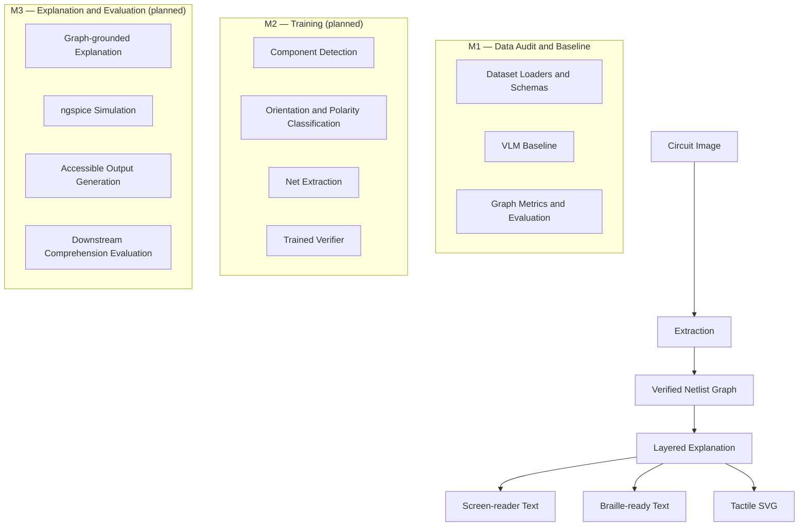

# Verified Circuit Access

**Making circuit diagrams accessible to blind students through verified, structured representations.**

## 1. Problem Statement

Circuit diagrams are widely used in high-school and undergraduate science and engineering education. However, these diagrams are primarily visual. Blind and visually impaired students may therefore be unable to independently identify electronic components, understand their electrical connections, and follow the overall structure of a circuit.

Existing text-to-speech and screen-reader tools cannot directly communicate the spatial and electrical relationships represented in circuit diagrams.

**Verified Circuit Access** aims to address this accessibility gap by converting circuit images into structured, verified representations that can eventually be communicated through screen readers, Braille displays, and tactile diagrams.

The central idea is to avoid presenting extracted circuit information as automatically correct. A verification layer is planned to identify potentially incorrect components and connections before explanations are generated.

## 2. Project Architecture

The planned system follows this pipeline:



### Milestones

**M1 — Data Audit and Baseline**

Establishes dataset governance, common annotation and netlist schemas, dataset loaders, evaluation metrics, and a provider-independent VLM baseline and evaluation framework.

**M2 — Training (planned, not started)**

- Component detection using a YOLO-family detector.
- Orientation, polarity, and crossing-versus-junction classification.
- Electrical net extraction.
- A trained verifier using gradient boosting and calibration.

**M3 — Explanation and Evaluation (planned, not started)**

- Layered explanations generated from verified circuit graphs.
- Numeric electrical facts grounded in ngspice simulation.
- Screen-reader text, Braille-ready output using liblouis, and tactile-printable SVG.
- Downstream comprehension evaluation.

## 3. M1 — Data Audit and Baseline

M1 establishes the data, representation, evaluation, and baseline infrastructure required for the circuit-understanding pipeline.

### 3.1 Dataset Audit and Data Governance

The project considers six datasets:

| Dataset | Intended use | Current status |
|---|---|---|
| Image2Net | Component annotations and circuit netlists | Validation data integrated; approved for academic/non-commercial use |
| CGHD | Additional circuit diagram and component data | Gated; licensing unresolved |
| AMSnet 2.0 | Additional circuit understanding data | Access and licensing verification pending |
| Masala-CHAI | Weakly labelled circuit data | Weak labels only; not for evaluation |
| SINA | Wire and net extraction | Access and licensing verification pending |
| CircuitReason-1k | Downstream circuit reasoning and comprehension | Distribution and image-use conditions need verification |

The dataset audit is documented in `DATASETS.md`.

It records:

- Official dataset source.
- Licensing and access conditions.
- Dataset size and annotation format.
- Intended use.
- Risks and restrictions.

Datasets with unresolved licensing or access conditions remain gated.

**Image2Net integration**

The Image2Net validation dataset from `LAD021/ci2n_datasets` has been integrated using a pinned source commit.

The local validation data contains:

- 122 circuit images.
- 122 corresponding golden JSON files.
- A dataset manifest recording source provenance.

The files are stored locally under `data/image2net/` and excluded from Git. They are not redistributed through the repository.

The academic/non-commercial use approval does not imply permission to redistribute the original dataset.

The CGHD loader remains deliberately gated through `DatasetGatedError`. No workaround or unofficial dataset source is used.

### 3.2 Unified Annotation Schema

Different circuit datasets use different annotation formats and component labels. A common representation is necessary to combine their information consistently.

Pydantic schemas are implemented in:

`src/vca/schemas/annotation.py`

The main structures are:

- `ImageRecord`
- `CategoryRecord`
- `BoundingBox`
- `AnnotationRecord`
- `COCODataset`

A bounding box represents the location of a component in an image using its coordinates, width, and height. An annotation associates that location with a component category and image.

This provides a common COCO-style representation for component annotations.

### 3.3 Harmonized Component Taxonomy

Different datasets may use different names or identifiers for the same electrical component.

A taxonomy mapping converts dataset-specific labels into canonical component categories.

Implemented in:

- `src/vca/schemas/taxonomy.py`
- `src/vca/schemas/taxonomy.json`

The taxonomy provides:

- Dataset-specific source-label mapping.
- Canonical component names and IDs.
- Case-insensitive lookup.
- An `unknown` fallback for unmapped labels.
- Preservation of original source labels.

The lookup function is:

```python
get_canonical(dataset_name, source_label)
```

It returns the canonical category and its corresponding ID.

Image2Net validation labels have been mapped to the project's canonical taxonomy, with no unknown labels in the inspected validation set.

### 3.4 Netlist Schema — Structured Electrical Representation

A netlist is a structured representation of an electrical circuit. It describes the components, their terminals, and the electrical connections between those terminals.

The Pydantic netlist schema is implemented in:

`src/vca/schemas/netlist.py`

The main structures are:

- **Component:** Represents an electrical component, its ID, canonical category, and terminals.
- **Terminal:** Represents an individual connection point on a component.
- **Net:** Represents an electrical connection shared by component terminals.
- **NetEndpoint:** Identifies a component terminal belonging to a net.
- **Netlist:** Contains the complete collection of components and nets.

The schema validates:

- Unique component IDs and net names.
- Unique terminal names within a component.
- Valid component and terminal references.
- At least one endpoint per net.
- No endpoint appearing in multiple nets.

The minimum endpoint count accommodates single-endpoint nets present in the Image2Net validation data, including ground-related connections.

The representation uses component-to-net relationships rather than treating a circuit as merely a collection of visual lines.

### 3.5 Dataset Loaders and Format Conversion

Dataset annotations must be converted into internal schemas before they can be used by downstream modules.

The Image2Net loader is implemented in:

`src/vca/data/image2net.py`

Supported operations include:

| Loader | Functionality |
|---|---|
| `load_labelme_json()` | Reads Labelme component annotations and converts them into the internal annotation schema |
| `load_yolo_obb()` | Converts YOLO oriented bounding-box polygon annotations into COCO-style bounding boxes |
| `load_validation_netlist()` | Converts validation netlist data into the Pydantic Netlist representation |

The loaders validate input structure, coordinates, required fields, and source labels. Malformed input produces contextual errors rather than silently generating invalid annotations.

The CGHD loader in `src/vca/data/cghd.py` remains gated through `DatasetGatedError` because its licensing evidence is unresolved.

### 3.6 Evaluation Metrics

Circuit extraction must be evaluated at both the component and electrical-connectivity levels.

The metric implementations are located in `src/vca/metrics/`.

#### 3.6.1 Normalized Edit Distance (NED)

NED measures the structural difference between a predicted netlist and its ground-truth netlist using graph edit distance.

The normalization used by the canonical implementation is:

\[
NED = \frac{GED}{N_{\text{devices}} + N_{\text{nets}} + N_{\text{ports}}}
\]

The implementation is in:

`src/vca/metrics/ned.py`

It constructs a canonical component-net incidence graph:

- Components and nets are represented as different node types.
- Component categories are preserved.
- Terminal names are preserved as edge labels.
- Component IDs and net names do not determine graph matching.
- Insertions, deletions, and incompatible substitutions use unit costs.

An empty ground-truth graph or a GED computation that times out returns `None`.

**Important:** This is the project's canonical NED implementation. It is not an exact reproduction of Image2Net's original GED implementation. Image2Net-compatible GED remains a separate metric task.

#### 3.6.2 Graph-Isomorphism Accuracy

This metric checks whether predicted and ground-truth circuit graphs have equivalent structures.

The implementation constructs a bipartite incidence graph containing component nodes and net nodes. Component categories and terminal relationships are preserved, while arbitrary component IDs and net names are ignored.

#### 3.6.3 Component Precision and Recall

These metrics evaluate whether predicted components match ground-truth components.

The component-matching framework uses Hungarian assignment, with matching constrained by:

- Canonical component categories.
- A maximum component-centre distance of 10 pixels.

The 10-pixel threshold is provisional and has not been established as a validated performance threshold.

#### 3.6.4 Connection Precision and Recall

These metrics compare electrical net endpoint sets while preserving component-terminal relationships.

The current component-correspondence implementation requires complete graph isomorphism. Consequently, connection precision and recall are not yet independent measures for non-isomorphic graphs. Such values must remain unavailable rather than being reported misleadingly.

### 3.7 Vision-Language Model (VLM) Baseline Interface

A Vision-Language Model can process circuit images and produce structured text or JSON representations.

M1 introduces a provider-independent interface for an image-to-netlist baseline.

Implemented in `src/vca/baseline/`:

- `provider.py`: Defines the abstract VLM provider interface and environment-variable validation.
- `interface.py`: Handles predictions, Netlist JSON validation, retries, and logging.
- `errors.py`: Defines errors for exhausted retries, configuration failures, and missing approval.

The interface retries when a provider returns invalid JSON and raises `VLMExhaustedError` when all attempts fail.

A mock provider is used for testing without making real API calls.

**Current limitation:** A real VLM provider has not yet been selected or integrated.

### 3.8 Evaluation Framework and Failure Overlays

The evaluation workflow is implemented in:

`src/vca/baseline/evaluation.py`

It connects image inputs, ground-truth netlists, the VLM interface, graph comparison, and results storage.

The workflow:

1. Checks explicit dataset and VLM approval before accessing inputs.
2. Discovers supported circuit image files.
3. Finds the corresponding ground-truth netlist.
4. Sends the image to the configured VLM.
5. Validates the returned Netlist.
6. Compares predicted and ground-truth graph structures.
7. Records evaluation outcomes and failures.
8. Generates available visual overlays.
9. Saves metrics and experiment metadata.

The overlay utility in `overlay.py` draws ground-truth annotations and predicted boxes when prediction coordinates are available.

The current VLM interface produces netlist-only predictions without bounding boxes. Predicted localization is therefore not fabricated. The current workflow uses ground-truth overlays with an explanatory legend.

The evaluation framework currently supports graph-isomorphism outcomes. Real VLM evaluation has not yet been performed.

### 3.9 Results Storage and Reproducibility

The results infrastructure is implemented in:

`src/vca/baseline/results.py`

Each evaluation run is designed to store:

- Metrics output.
- Configuration information.
- Git commit SHA.
- Random seed.
- Dataset and input provenance through the evaluation manifest.

The implementation avoids overwriting previous results when a run ID is reused.

Results are stored locally and excluded from Git by default.

No real VLM evaluation metrics are currently claimed.

### 3.10 Automated Testing and Code Quality

M1 includes unit tests and property-based tests for schemas, loaders, metrics, and the VLM interface.

The project uses:

- **pytest:** Automated unit and integration testing.
- **Hypothesis:** Property-based testing.
- **Ruff:** Python linting and code-quality checks.

Tests cover schema validation, serialization, taxonomy lookup, annotation conversion, metric invariants, graph operations, and VLM retry behaviour.

**Latest reported verification:**

- **117 tests passed.**
- **Ruff:** All checks passed.

These are software test results, not real-data model evaluation results.

## 4. Technology Stack

| Technology | Purpose |
|---|---|
| Python 3.11 | Primary implementation language |
| Pydantic | Structured data validation |
| NetworkX | Graph construction, graph isomorphism, and graph edit distance |
| SciPy | Hungarian assignment for component matching |
| Pillow | Evaluation overlays |
| pytest | Automated testing |
| Hypothesis | Property-based testing |
| Ruff | Linting |
| uv | Dependency and environment management |

## 5. Setup and Reproduction

### Prerequisites

- Python 3.11
- pip
- Git
- Linux, macOS, or another compatible Python environment

### Step 1: Clone the repository

```bash
git clone <repository-url>
cd verified-circuit-access
```

### Step 2: Create and activate a virtual environment

```bash
python3.11 -m venv .venv
source .venv/bin/activate
```

On Windows:

```powershell
.venv\Scripts\activate
```

### Step 3: Install dependencies

Using pip:

```bash
pip install -e ".[dev]"
```

Alternatively, using the existing uv lockfile:

```bash
uv sync --locked
```

### Step 4: Configure environment variables

Copy the example environment file only when configuring a provider that needs credentials:

```bash
cp .env.example .env
```

The `.env.example` file documents the expected environment-variable configuration. Real credentials must never be committed to Git.

### Step 5: Dataset preparation

Review `DATASETS.md` before accessing any dataset.

The Image2Net validation files are expected under:

```text
data/image2net/
├── images/
├── golden/
└── manifest.json
```

These files are not included in the Git repository. Follow the dataset source and access conditions before downloading or using them.

The current `make data` target is a placeholder. An interactive dataset approval and download workflow has not yet been implemented.

### Step 6: Evaluation

The intended command is:

```bash
make eval
```

The current Makefile evaluation target is a placeholder and does not yet execute the complete real-data VLM evaluation.

The Python evaluation framework requires separate explicit dataset and VLM approvals through:

```python
data_approved=True
vlm_approved=True
```

These approvals do not override unresolved dataset licensing restrictions.

No real VLM API evaluation has been completed.

### Step 7: Demo

```bash
make demo
```

The demo target is currently a placeholder and does not launch a complete application.

### Step 8: Run tests and lint

Run the full test suite:

```bash
pytest -v
```

Run lint checks:

```bash
ruff check .
```

## 6. Dataset Approval and Access Status

Dataset approval is tracked separately from implementation.

| Dataset | Status | Notes |
|---|---|---|
| Image2Net (`ci2n_datasets`) | Approved for academic/non-commercial use | Validation data integrated locally; original-source licensing caveats still apply |
| CGHD | Gated | Conflicting license information; release licensing unresolved |
| AMSnet 2.0 | Pending | License and confirmed public access or distribution unverified |
| Masala-CHAI | Pending | License and distribution source unclear; weak labels only |
| SINA | Pending | Explicit license and dataset distribution source unverified |
| CircuitReason-1k | Pending | Image distribution and usage rights need verification |

Refer to `DATASETS.md` for the detailed source, license, format, size, intended use, and risk audit.

Dataset approval and VLM approval are separate. Approval to use one dataset does not authorize access to another dataset or use of a real API provider.

## 7. Evaluation Metrics and Results

The following metrics form part of the M1 evaluation design.

| Metric | Implementation status | Real-data result |
|---|---|---|
| Canonical NED | Implemented and unit-tested | Not run |
| Image2Net-compatible GED | Pending | Not run |
| Graph-isomorphism accuracy | Implemented | Not run |
| Component precision | Framework available; evaluation needs completion | Not run |
| Component recall | Framework available; evaluation needs completion | Not run |
| Connection precision | Limited by component correspondence | Not run |
| Connection recall | Limited by component correspondence | Not run |

No passing thresholds have been experimentally established.

### Metric definitions

- **Normalized Edit Distance:** Measures normalized graph-edit differences between predicted and ground-truth netlists.
- **Graph-isomorphism accuracy:** Measures whether predicted and ground-truth circuit graphs have equivalent structures.
- **Component precision:** Measures the proportion of predicted components that match ground-truth components.
- **Component recall:** Measures the proportion of ground-truth components successfully matched.
- **Connection precision:** Measures the proportion of predicted connections that match ground-truth connections.
- **Connection recall:** Measures the proportion of ground-truth connections successfully recovered.

Component matching currently uses Hungarian assignment, canonical categories, and a provisional centre-distance threshold of 10 pixels.

Connection matching currently depends on full graph isomorphism for component correspondence. Consequently, it cannot independently quantify connection errors when the graphs are not isomorphic.

All real-data metrics must be generated through actual evaluation runs and saved with their configuration, seed, and Git commit hash. Metrics that have not been computed must remain marked `not run`.

## 8. Project Structure

```text
verified-circuit-access/
├── DATASETS.md
├── PLAN.md
├── README.md
├── Makefile
├── pyproject.toml
├── uv.lock
├── .env.example
├── src/
│   └── vca/
│       ├── schemas/
│       │   ├── annotation.py
│       │   ├── netlist.py
│       │   └── taxonomy.py
│       ├── data/
│       │   ├── image2net.py
│       │   └── cghd.py
│       ├── metrics/
│       │   ├── ned.py
│       │   └── graph_iso.py
│       ├── baseline/
│       │   ├── provider.py
│       │   ├── interface.py
│       │   ├── evaluation.py
│       │   ├── overlay.py
│       │   ├── results.py
│       │   └── errors.py
│       ├── detect/       # M2
│       ├── classify/     # M2
│       ├── netting/      # M2
│       ├── verify/       # M2
│       ├── explain/      # M3
│       └── outputs/      # M3
└── tests/
    ├── schemas/
    ├── data/
    ├── metrics/
    └── baseline/
```

Dataset files and generated evaluation results are excluded from version control according to `.gitignore`.

## 9. Reproducibility and Project Rules

The project follows these rules:

- Use Python 3.11 and pinned dependencies.
- Use real datasets only after explicit approval.
- Never generate synthetic training or evaluation images or labels.
- Do not commit dataset images, copyrighted textbook material, API credentials, or generated evaluation results.
- Record configuration, random seed, and Git commit hash for actual evaluation runs.
- Report uncomputed metrics as `not run`.
- Keep M2 and M3 functionality separate from M1 until those milestones are explicitly approved.
- Keep gated datasets inaccessible until their licensing and access requirements are resolved.
- Do not fabricate predicted bounding boxes or numeric circuit results.

## 10. Current Project Status

**Current milestone: M1 — Data Audit and Baseline**

The repository currently contains:

- Pydantic annotation and netlist schemas.
- A harmonized component taxonomy.
- Image2Net validation data integration and loaders.
- A deliberately gated CGHD loader.
- Graph-isomorphism evaluation.
- Canonical normalized graph edit distance.
- A provider-independent VLM baseline interface.
- A preliminary evaluation and results-storage framework.
- Automated tests and lint checks.

Latest software verification:

- 117 tests passed.
- Ruff checks passed.
- Latest NED implementation commit: `722c40b`.

### Remaining M1 work

1. Complete and verify the dataset audit.
2. Verify the unified COCO annotation format and taxonomy coverage across approved datasets.
3. Implement and validate Image2Net-compatible GED separately from canonical NED.
4. Complete independent component and connection precision/recall evaluation.
5. Select and integrate a real VLM provider.
6. Run the baseline evaluation on the approved labelled circuits.
7. Save actual metrics, experiment metadata, and failure-case overlays.
8. Complete the README and Makefile reproduction workflow.

M1 does not yet provide a trained circuit detector, a completed real VLM evaluation, or accessible circuit explanations.

M2 will build the models that extract and verify circuit information from images. M3 will use the verified circuit representation to generate explanations and accessible outputs for blind students.

**M2 and M3 remain planned. Work on them will begin only after M1 is completed and explicitly approved.**

See `PLAN.md` for the complete milestone plan and `DATASETS.md` for dataset approval details.