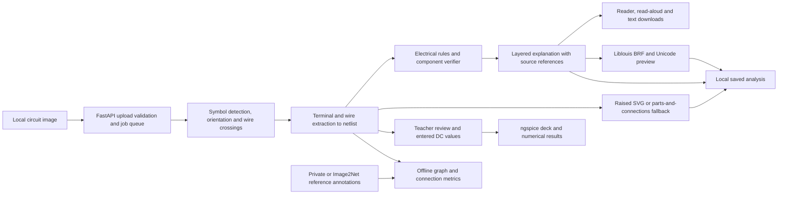

# VERIFIED-CIRCUIT-ACCESS

Braille Press helps blind and low-vision students read circuit diagrams with a
teacher. A diagram conveys information through symbols, terminal positions and
wires that a student may otherwise need a sighted reader to interpret. The
application extracts a machine-read netlist and turns it into a layered
explanation with component and net references.

## Run the local demo

The engine requires Python 3.11, uv, the archived M2 weights, and the Image2Net
validation images for the examples and Library. The frontend uses Node.js and
npm. Liblouis enables BRF and Unicode previews. ngspice enables teacher-entered
DC calculations. On macOS these optional system packages are available as
`liblouis` and `ngspice` through Homebrew.

From the repository root:

```sh
uv sync --locked --extra train --extra api
npm --prefix web ci
uv run --extra train python scripts/build_demo_data.py \
  --pipeline-run results/m2/pipeline/20261111T171400Z \
  --verifier-run results/m2/verifier/20261111T171904Z \
  --images-dir data/image2net/images --out demo/data
npm --prefix web run sync-data
npm --prefix web run build
bash scripts/start_demo.sh
```

Open [the production demo](http://127.0.0.1:3017). Use `PORT=3018` before the
launcher if 3017 is occupied. Ctrl-C stops the frontend and engine.
For development, run `uv run --extra train --extra api python scripts/serve_api.py`
and `npm --prefix web run dev -- --hostname 127.0.0.1 --port 3017` in separate
terminals. The Next.js proxy forwards API requests to the engine at
`127.0.0.1:8000`.

Set `VCA_BRAILLE_TABLE` to choose a compatible six-dot Liblouis table. The
default is `en-ueb-g1.ctb` for Unified English Braille grade 1. Set
`VCA_TACTILE_LINE_MM` to change SVG line thickness from the 1.1 mm default.
Apply these settings when building the Library or starting the engine. Choose
A4 or Letter in the Raised diagram tab.

Run `uv run python scripts/prewarm_demo.py` while the engine is up to populate
the six example caches with fresh CPU results. The interface labels saved
results and offers **Run again**. Older saved analyses need a fresh run to
generate the newer outputs.

## System architecture



## Project contribution

The prototype combines a schematic netlist, traceable explanations, part-level
review flags, and a teacher workflow in one local tool. It uses established
detection, graph evaluation, braille translation, and circuit simulation
methods. The project has no comparative novelty or learning-outcome study.

## Status

| Area | Current status |
|---|---|
| Extraction | Pinned M2 CPU pipeline with symbol, crossing and orientation models |
| Review | Rule checks and component verifier flag parts for teacher review |
| Try it and Library | Local upload, saved runs, three text layers, read-aloud and text downloads |
| Braille | Liblouis grade 1 BRF and Unicode preview where generated |
| Raised output | A4 and Letter vector output, with a labelled connections listing when routes are unclear |
| Calculation | ngspice DC readings from teacher-entered values on supported circuits |
| Curriculum evaluation | Annotation kit and evaluator are ready. No figures have been annotated or evaluated. |
| Saved evaluation | Image2Net pipeline and verifier metrics are shown on the app’s Status page. |

## 5. Technology stack

| Area | Technology |
|---|---|
| Programming language | Python 3.11 |
| Graph representation | NetworkX |
| Data validation | Pydantic |
| Image handling | Pillow |
| Numerical operations | SciPy |
| Testing | pytest |
| Property-based testing | Hypothesis |
| Code quality | Ruff |
| Dataset integration | Image2Net validation dataset |

Dependencies are pinned in `pyproject.toml`, and the repository includes a `uv.lock` lockfile.

## 6. Project structure

```text
verified-circuit-access/
│
├── data/
│   └── image2net/
│       ├── images/
│       ├── golden/
│       └── manifest.json
│
├── scripts/
│   ├── download_image2net_validation.py
│   ├── download_training_data.py
│   ├── list_image2net_labels.py
│   ├── prepare_m2_data.py
│   ├── train_orientation.py
│   ├── eval_netting_oracle.py
│   └── eval_pipeline.py
│
├── notebooks/
│   ├── m2_kaggle_train.ipynb
│   └── m2_kaggle_orientation_netting.ipynb
│
├── src/
│   └── vca/
│       ├── schemas/
│       │   ├── annotation.py
│       │   ├── netlist.py
│       │   └── taxonomy.py
│       │
│       ├── data/
│       │   ├── image2net.py
│       │   └── cghd.py
│       │
│       ├── metrics/
│       │   ├── ned.py
│       │   └── graph_iso.py
│       │
│       ├── detect/          # detector class map, YOLO dataset builder
│       ├── classify/        # orientation and crossing datasets
│       ├── netting/         # terminals, orientation, net extraction
│       ├── verify/          # electrical rule checks
│       ├── pipeline.py      # image -> netlist with per-component evidence
│       ├── training.py      # Ultralytics training with recorded provenance
│       │
│       └── baseline/
│           ├── errors.py
│           ├── evaluation.py
│           ├── interface.py
│           ├── overlay.py
│           ├── provider.py
│           └── results.py
│
├── tests/
│   ├── schemas/
│   ├── data/
│   ├── metrics/
│   ├── baseline/
│   ├── detect/
│   ├── classify/
│   ├── netting/
│   └── verify/
│
├── .env.example
├── .gitignore
├── Makefile
├── pyproject.toml
├── uv.lock
├── DATASETS.md
├── PLAN.md
└── README.md
```

The `data/` directory is local project data and is not intended to be committed to Git. The structure shown represents the current implementation and its principal modules.

## 7. Dataset integration

### Image2Net validation dataset

The project integrates the validation data from the Image2Net dataset repository:

**Source:** [LAD021/ci2n_datasets](https://github.com/LAD021/ci2n_datasets)

**Pinned source commit:**

```text
2ffd41b2255726eb1be215fa7ba1d9808c80c808
```

The local validation dataset contains:

- 122 circuit diagram images.
- 122 corresponding golden JSON annotation files.
- A local manifest recording each file's SHA-256.

The Image2Net paper reports 104 verified pairs; the repository's `validation/` folder holds 122 at the pinned commit. The baseline is evaluated on all 122, and the count is recorded with every run.

The dataset is stored under:

```text
data/image2net/
├── images/
├── golden/
└── manifest.json
```

The dataset integration includes:

- Loading circuit images and corresponding annotations.
- Normalizing the annotation structure.
- Mapping dataset component labels to the project's component taxonomy.
- Constructing structured netlist representations.
- Supporting downstream graph-based evaluation.

The dataset-wide taxonomy audit covered 1,573 components and found zero unknown component labels.

### Dataset access and licensing

Dataset access and licensing conditions are documented in `DATASETS.md`.

This is a research project; licensing notes are kept in `DATASETS.md` for reference.

The dataset is not distributed through this repository. A fresh clone does not contain the images or annotation files; download them as below.

### Downloading the validation data

```bash
make data
```

The script lists the `validation/` folder at the pinned commit, downloads every image/golden pair into `data/image2net/`, and writes the manifest.

The currently verified local dataset contains 122 pairs.

**Note:** The dataset is excluded from Git. Do not commit dataset images, golden annotation files, or other restricted dataset contents.

### CGHD dataset

`vca.data.cghd.load_pascal_voc` parses CGHD's PASCAL VOC box files into the shared COCO-style records (`ImageRecord`, `AnnotationRecord`), keeping the raw label in `source_label` and reading `<rotation>` when present. CGHD labels not yet in the taxonomy map to `unknown` and are returned in `unmapped_labels` so they can be added deliberately. CGHD's 12 LTspice `.asc` netlists are not used.

### M2 training data

`make prepare-m2` builds four datasets under `data/m2/` (seed 42, 15 % validation):

| Dataset | Source | Train / val | Notes |
|---|---|---|---|
| `detector_i2n` | Image2Net `device_identification` | 1,899 / 333 images | 22 detector classes |
| `detector_i2n_cghd` | the above + CGHD (train only) | 5,168 / 333 images | 18,076 CGHD boxes with no matching class painted out |
| `orientation` | Image2Net `device_orientation` | 8 tasks | split by drawing, so a crop's rotations never straddle the split |
| `crossing` | Image2Net `jumper_identification` | 714 / 123 images | YOLO-OBB: hop, dot junction, T-junction |

Leakage: 37 detection images and 18 crossing images copy (exactly or near) one of the 122 netlist-evaluation circuits and are dropped. Train/val splits are made by near-duplicate group, and the detector's val split is Image2Net only.

Orientation classifiers train with horizontal flipping off (`--fliplr 0`): a flip turns an `l` crop into `r` and changes the mirror state, so Ultralytics' default mislabels half the flipped samples.

Image2Net's golden netlists treat a plain four-way wire crossing without a dot as connected in at least one circuit (1768), while the crossing labels leave plain crossings unlabelled. The extractor can cut plain crossings or keep them joined (`--no-plain-crossings`); which convention matches the golden netlists is being measured.

### M2 pipeline

`vca.pipeline.Pipeline`: detector -> crossing model -> orientation classifiers -> net extraction (`vca.netting.extract`) -> rule checks (`vca.verify.rules`). It returns the netlist plus one evidence row per component (detector score, orientation source and confidence, unmatched terminals, extra wire contacts, rule flags) for the verifier. `scripts/eval_pipeline.py` runs it on the validation circuits and saves, per circuit, the prediction, the evidence, the GED alignment to the golden netlist and the component errors it implies.

Latest run (122 Image2Net validation circuits, `results/m2/pipeline/20261111T171400Z`): macro NED 0.131 (lower bound 0.070), graph isomorphism 32.0 %, connection precision/recall 0.74/0.77.

`scripts/train_verifier.py` trains the component verifier (`vca.verify.model`: gradient boosting plus isotonic calibration, folds split by circuit) on such a run. On the run above (1,572 components, 27.1 % wrong), cross-validated by circuit: AUROC 0.66, ECE 0.021, Brier 0.184 (`results/m2/verifier/20261111T171904Z`). The strong rule flags (shorts, unconnected terminals) are always right but catch 7.5 % of the wrong components.

## 8. Data schemas

The project uses structured schemas to maintain consistency between extracted circuit information and evaluation.

The principal schema modules are:

| Schema | Purpose |
|---|---|
| `annotation.py` | Represents circuit annotation information |
| `netlist.py` | Represents circuit components, terminals, nets, and connections |
| `taxonomy.py` | Defines and normalizes component categories |

The netlist representation retains terminal-level connection information. This is important because two circuits containing the same components may still have different electrical topologies.

The schemas use Pydantic for data validation.

## 9. Graph representation

Circuit netlists are converted into canonical component-net incidence graphs.

The graph contains:

- **Component nodes:** Represent electrical components and their canonical categories.
- **Net nodes:** Represent electrical nets.
- **Edges:** Represent connections between component terminals and nets.
- **Terminal labels:** Preserve which terminal of a component is connected to a particular net.

This representation allows the evaluation framework to compare electrical connectivity rather than relying on component identifiers or net names.

Component IDs and net names are not treated as the defining basis of graph equivalence.

## 10. Evaluation metrics

All metrics compare the predicted and golden netlists as component-net incidence multigraphs: component nodes carry their category, net nodes are anonymous, and each edge carries the terminal name. Following Image2Net, two-terminal devices without polarity (resistor, capacitor, inductor, switch) use a single terminal label, so drawing them backwards is not an error; polar devices (MOS drain/source, diode, sources, amplifier inputs) keep distinct labels.

### 10.1 Graph isomorphism

A prediction is correct when its graph is isomorphic to the golden graph with matching categories and terminal labels on every edge.

Implementation:

```text
src/vca/metrics/graph_iso.py
```

### 10.2 Normalized graph edit distance (NED)

NED follows Image2Net's definition: the graph edit distance with unit costs, divided by the size of the golden graph (components + nets + terminal connections). 0 is a perfect match.

Implementation:

```text
src/vca/metrics/ned.py
```

The metric compares canonical component-net incidence graphs using graph edit operations.

Exact GED is NP-hard. The search (`networkx.optimize_edit_paths`) runs until a timeout (30 s by default). If it stops early, its best path can be far from optimal on circuits with a few dozen components, and more time barely helps. In that case an assignment-based mapping is also priced (`src/vca/metrics/assignment_ged.py`: components matched by category and wiring, nets and components re-matched in turn, then improving swaps), and the cheaper of the two edit paths is used. Either way the NED is the cost of a real edit path, so it is an upper bound, flagged `ned_exact: false`.

The bound matters: on the full pipeline's 122 predictions it lowered macro NED from 0.607 to 0.234 with the predictions unchanged. NED numbers are only comparable when scored with the same alignment code; graph-isomorphism accuracy does not depend on the search.

The same best edit path gives a node alignment between prediction and golden circuit. That alignment drives:

- **Component precision/recall:** aligned components with the same category.
- **Connection precision/recall:** nets whose aligned terminal sets match exactly.
- **Error diagnosis** per circuit: `missed_component`, `extra_component`, `wrong_component_type`, `wrong_polarity` (same terminals and nets, assigned the wrong way round, e.g. drain/source swapped), `wrong_connection`.

### 10.3 Evaluation framework

The evaluation framework provides infrastructure for:

- Comparing predicted circuit representations with ground truth.
- Computing graph-based metrics.
- Recording evaluation outputs.
- Generating visual overlays.
- Storing evaluation results.

Implementation:

```text
src/vca/baseline/evaluation.py
src/vca/baseline/overlay.py
src/vca/baseline/results.py
```

Each run writes to `results/baseline/<run_id>/`: the raw prediction for every circuit (so a run can be re-scored without new API calls) and an overlay image for every incorrect circuit, with predicted boxes labelled by error kind.

## 11. VLM baseline infrastructure

The project contains a baseline interface for vision-language model predictions.

The baseline infrastructure separates:

- Provider integration.
- Prediction interfaces.
- Evaluation.
- Error handling.
- Overlay generation.
- Results storage.

Relevant modules:

```text
src/vca/baseline/
├── errors.py
├── evaluation.py
├── interface.py
├── overlay.py
├── provider.py
└── results.py
```

The baseline provider is `anthropic_provider.py`: one Claude call per image (default `claude-opus-5-5`, effort `high`), with structured outputs constraining the reply to the netlist schema, category and terminal names restricted to the taxonomy, and component boxes returned as fractions of the image and converted to pixels. Invalid replies are retried with the validation error as context (`--max-retries`, default 3). Refusals and truncated replies count as failed attempts.

Server-side model fallbacks are deliberately not enabled: they could silently answer with a different model and confound the baseline. The served model and token counts of every call are saved in `<run_id>_calls.json`.

Claude models do not expose sampling temperature, so two runs are not bit-for-bit identical; the saved predictions are the record of what was scored.

A mock provider is used only in tests. It must not be treated as evidence of model performance.

Predictions that do not contain bounding-box information must not be assigned fabricated bounding boxes. Some spatial or terminal-orientation evaluations may therefore be marked as not evaluated when the required evidence is unavailable.

## 12. Reproducibility and evaluation results

The project uses:

- Pinned Python dependencies.
- A tracked `uv.lock` lockfile.
- Fixed-seed testing practices.
- pytest for automated tests.
- Ruff for code-quality checks.
- Dataset source commit information.
- Local result storage for evaluation provenance.

Evaluation results must be associated with their relevant configuration, random seed, and Git commit.

No model-performance metrics should be interpreted as established until an actual evaluation has been executed and its provenance recorded.

### Current verification status

| Verification | Status |
|---|---|
| Full automated test suite | Run the checks below for the current checkout |
| Ruff checks | Passed |
| Dataset validation pairs | 122 downloaded/verified locally |
| Dataset taxonomy audit | 1,573 components; zero unknown labels |
| Model training | M2 detector, crossing and orientation models trained (Kaggle) |
| Real VLM evaluation | Pending |
| Circuit simulation | Automated series, parallel and divider fixtures. A curriculum evaluation remains pending. |
| End-to-end accessibility evaluation | Not run |

The test results above refer to the latest recorded project verification. Run the commands below to verify the current checkout independently.

## 13. Installation and setup

### Prerequisites

- Linux, macOS, or Windows with a compatible Python environment.
- Python 3.11.x.
- Git.
- pip, or uv if using the lockfile-based setup.

Check your Python version:

```bash
python --version
```

The project requires:

```text
Python >=3.11,<3.12
```

### Clone the repository

```bash
git clone https://github.com/niksi-nova/verified-circuit-access.git
cd verified-circuit-access
```

For the Braille Press demo branch:

```bash
git switch feat/demo-explanation
```

### Option A: Install using pip

Create a virtual environment:

```bash
python3.11 -m venv .venv
```

Activate it on Linux/macOS:

```bash
source .venv/bin/activate
```

On Windows PowerShell:

```powershell
.venv\Scripts\Activate.ps1
```

Upgrade pip:

```bash
python -m pip install --upgrade pip
```

Install the project and development dependencies:

```bash
python -m pip install -e ".[dev]"
```

### Option B: Install using uv

Install uv:

```bash
python -m pip install uv
```

Synchronize the environment using the tracked lockfile:

```bash
uv sync --locked
```

Activate the environment on Linux/macOS:

```bash
source .venv/bin/activate
```

Use either the pip installation route or the uv installation route. There is no need to perform both.

### Environment variables

The baseline reads `ANTHROPIC_API_KEY` from the environment (see `.env.example`, which holds only the empty variable name). Never commit API keys, access tokens, passwords, or other secrets.

## 14. Running tests and code-quality checks

Activate the virtual environment before running the commands.

Run the full test suite:

```bash
python -m pytest
```

Run tests with verbose output:

```bash
python -m pytest -v
```

Run Ruff:

```bash
ruff check .
```

Check formatting:

```bash
ruff format --check .
```

These commands verify the current codebase. The reported historical test count should not be assumed if the implementation or dependencies have changed.

## 15. Makefile commands

The repository defines the following Makefile targets (GPU training normally runs on Kaggle through the notebooks in `notebooks/`):

| Target | Behavior |
|---|---|
| `make data` | Downloads the 122 Image2Net validation pairs into `data/image2net/` |
| `make eval` | Runs the Claude baseline on all circuits; extra flags via `ARGS="--limit 5"` |
| `make rescore PRED=<dir>` | Re-scores saved predictions without API calls |
| `make data-train` | Downloads the Image2Net training subsets and CGHD |
| `make prepare-m2` | Builds `data/m2/` and the two Kaggle upload zips |
| `make train-orientation` | Trains the eight orientation/mirroring classifiers (local GPU) |
| `make eval-netting-oracle` | Net extraction on hand-drawn boxes (37 circuits) |
| `make eval-pipeline ARGS=...` | Full pipeline on the 122 circuits with trained weights |
| `make test` / `make lint` | pytest / ruff |
| `make demo` | Stops; the accessible-output demo is M3 |

## 16. Dataset and model approval requirements

Dataset approval and real VLM provider approval are separate requirements.

- Dataset access must follow the conditions documented in `DATASETS.md`.
- Real model-provider calls require explicit approval (`--vlm-approved`, set by `make eval`).
- Mock-provider tests do not require real API credentials.

The evaluation framework must not silently substitute synthetic data or mock predictions for real evaluation data.

## 17. Development principles

The project follows these principles:

1. **Structured representation:** Circuit information should be represented through validated schemas and graph structures.
2. **Traceability:** Predictions and evaluation results should retain their provenance.
3. **Verification:** Explanations should be grounded in verified circuit information.
4. **No fabricated evidence:** Missing spatial, terminal, or numerical evidence must not be invented.
5. **Reproducibility:** Dependencies, configurations, seeds, and source versions should be recorded.
6. **Dataset compliance:** Data access and licensing requirements must be respected.
7. **Accessibility:** The final system should support non-visual understanding of circuit diagrams.

## Limitations

- Machine-read circuits can miss symbols and misconnect terminals. A teacher can
  record decisions and sign off in their browser. Review decisions leave the
  underlying netlist unchanged.
- The examples come from the evaluation set. New textbook figures still need
  independent evaluation. The [annotation guide](docs/annotation_guideline.md)
  explains the private workflow.
- Braille has not been proofread by a braille reader. Raised graphics have not
  been validated by a tactile-graphics expert. The routing uses predicted
  terminals and a conservative clearance test. Most of the current Library uses
  the labelled connections listing.
- Calculation is limited to resistors and independent DC voltage and current
  sources. It requires teacher-entered values and connected nets. The
  application has no value OCR or simulation support for transistors, diodes,
  and other electrical parts.
- The project has no completed comprehension study, blind student or teacher
  usability study, or general-purpose vision model comparison.

## 19. Documentation

Additional project documentation:

- `DATASETS.md` — Dataset sources, licensing, access, and audit information.
- `PLAN.md` — Project milestones and implementation plan.

For implementation details, refer to the corresponding modules under `src/vca/`.

---

**Project:** VERIFIED-CIRCUIT-ACCESS
**Current milestone:** M2 local demo and output integration
**Repository:** https://github.com/niksi-nova/verified-circuit-access
