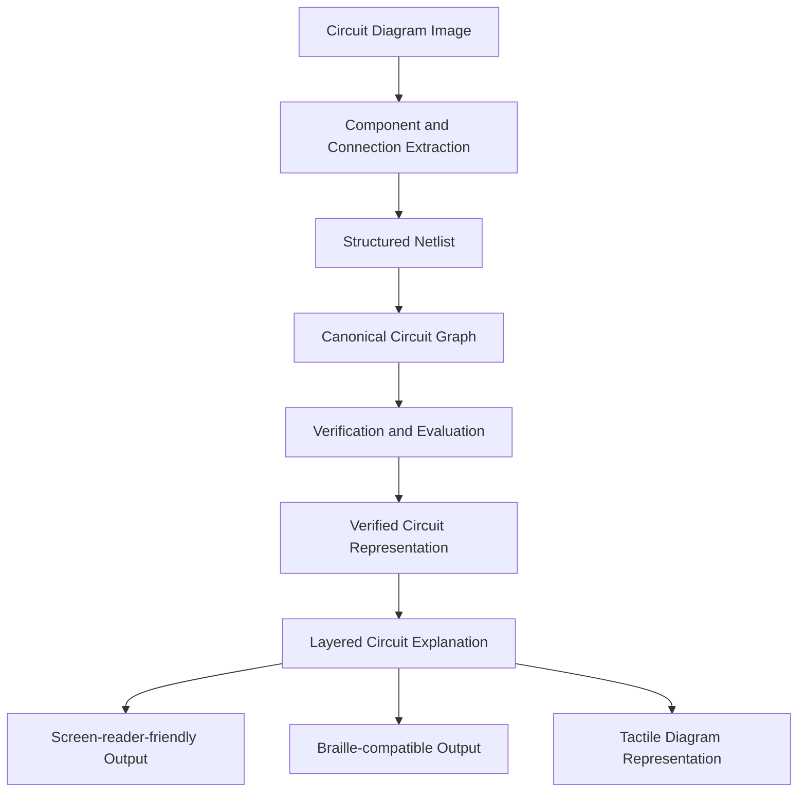

# VERIFIED-CIRCUIT-ACCESS

**Verified circuit diagram understanding and accessible explanations for blind and visually impaired students.**

VERIFIED-CIRCUIT-ACCESS is a system designed to convert circuit diagram images into structured, verified electrical representations and accessible explanations. It aims to make circuit diagrams easier to understand through screen-reader-friendly descriptions and other accessible representations.

## 1. Project overview

Circuit diagrams contain visual information such as components, terminals, wires, connections, labels, and electrical relationships. For blind and visually impaired students, understanding these diagrams can be difficult because conventional learning materials rely heavily on visual interpretation.

This project aims to bridge that gap by developing a pipeline that:

1. Extracts circuit components and connections from circuit diagram images.
2. Represents the extracted circuit as a structured netlist graph.
3. Evaluates the correctness of the extracted representation.
4. Uses verified graph information to generate circuit explanations.
5. Supports accessible output formats such as screen-reader-friendly text, Braille-compatible descriptions, and tactile diagram representations.

The project prioritizes verification and traceability rather than relying solely on generated explanations.

## 2. System architecture



The intended architecture separates extraction, graph representation, verification, and explanation. This allows the correctness of the underlying circuit representation to be evaluated independently of the generated explanation.

## 3. Main objectives

- Develop structured schemas for circuit annotations, components, terminals, and electrical connections.
- Integrate circuit diagram datasets with documented licensing and access conditions.
- Convert netlists into canonical graph representations.
- Evaluate extracted circuits using graph-based metrics.
- Establish a baseline interface for vision-language model predictions.
- Identify potentially incorrect extractions for review.
- Ensure numerical explanations are grounded in circuit simulation results.
- Develop accessible representations suitable for blind and visually impaired students.

## 4. Repository status

The repository currently contains the foundational implementation for Milestone 1 (M1).

| Component | Current status |
|---|---|
| Project configuration and development setup | Implemented |
| Annotation schema | Implemented |
| Netlist schema | Implemented |
| Component taxonomy | Implemented |
| Image2Net dataset integration | Implemented |
| Dataset taxonomy audit | Implemented |
| CGHD PASCAL VOC box loader | Implemented (LTspice netlists: M2) |
| Graph isomorphism metric | Implemented |
| Normalized graph edit distance (NED) | Implemented |
| VLM baseline (Claude provider + CLI) | Implemented |
| Evaluation framework | Implemented |
| Evaluation overlays | Implemented |
| Results storage | Implemented |
| Trained component verifier | Not implemented |
| ngspice-based numerical verification | Not implemented |
| Accessible explanation generation | Future implementation |
| Screen-reader, Braille, and tactile output | Future implementation |

**Important:** Implemented infrastructure does not imply that a trained model or complete end-to-end system is available. No model has been trained, and no baseline numbers are reported until the evaluation in section 12 has been run.

## 5. Technology stack

| Area | Technology |
|---|---|
| Programming language | Python 3.11 |
| Graph representation | NetworkX |
| Data validation | Pydantic |
| Image handling | Pillow |
| Numerical operations | SciPy |
| Testing | pytest |
| Property-based testing | Hypothesis |
| Code quality | Ruff |
| Dataset integration | Image2Net validation dataset |

Dependencies are pinned in `pyproject.toml`, and the repository includes a `uv.lock` lockfile.

## 6. Project structure

```text
verified-circuit-access/
│
├── data/
│   └── image2net/
│       ├── images/
│       ├── golden/
│       └── manifest.json
│
├── scripts/
│   ├── download_image2net_validation.py
│   └── list_image2net_labels.py
│
├── src/
│   └── vca/
│       ├── schemas/
│       │   ├── annotation.py
│       │   ├── netlist.py
│       │   └── taxonomy.py
│       │
│       ├── data/
│       │   ├── image2net.py
│       │   └── cghd.py
│       │
│       ├── metrics/
│       │   ├── ned.py
│       │   └── graph_iso.py
│       │
│       └── baseline/
│           ├── errors.py
│           ├── evaluation.py
│           ├── interface.py
│           ├── overlay.py
│           ├── provider.py
│           └── results.py
│
├── tests/
│   ├── schemas/
│   ├── data/
│   ├── metrics/
│   └── baseline/
│
├── .env.example
├── .gitignore
├── Makefile
├── pyproject.toml
├── uv.lock
├── DATASETS.md
├── PLAN.md
└── README.md
```

The `data/` directory is local project data and is not intended to be committed to Git. The structure shown represents the current implementation and its principal modules.

## 7. Dataset integration

### Image2Net validation dataset

The project integrates the validation data from the Image2Net dataset repository:

**Source:** [LAD021/ci2n_datasets](https://github.com/LAD021/ci2n_datasets)

**Pinned source commit:**

```text
2ffd41b2255726eb1be215fa7ba1d9808c80c808
```

The local validation dataset contains:

- 122 circuit diagram images.
- 122 corresponding golden JSON annotation files.
- A local manifest recording each file's SHA-256.

The Image2Net paper reports 104 verified pairs; the repository's `validation/` folder holds 122 at the pinned commit. The baseline is evaluated on all 122, and the count is recorded with every run.

The dataset is stored under:

```text
data/image2net/
├── images/
├── golden/
└── manifest.json
```

The dataset integration includes:

- Loading circuit images and corresponding annotations.
- Normalizing the annotation structure.
- Mapping dataset component labels to the project's component taxonomy.
- Constructing structured netlist representations.
- Supporting downstream graph-based evaluation.

The dataset-wide taxonomy audit covered 1,573 components and found zero unknown component labels.

### Dataset access and licensing

Dataset access and licensing conditions are documented in `DATASETS.md`.

This is a research project; licensing notes are kept in `DATASETS.md` for reference.

The dataset is not distributed through this repository. A fresh clone does not contain the images or annotation files; download them as below.

### Downloading the validation data

```bash
make data
```

The script lists the `validation/` folder at the pinned commit, downloads every image/golden pair into `data/image2net/`, and writes the manifest.

The currently verified local dataset contains 122 pairs.

**Note:** The dataset is excluded from Git. Do not commit dataset images, golden annotation files, or other restricted dataset contents.

### CGHD dataset

`vca.data.cghd.load_pascal_voc` parses CGHD's PASCAL VOC box files into the shared COCO-style records (`ImageRecord`, `AnnotationRecord`), keeping the raw label in `source_label` and reading `<rotation>` when present. CGHD labels not yet in the taxonomy map to `unknown` and are returned in `unmapped_labels` so they can be added deliberately. LTspice `.asc` netlist conversion is part of M2.

## 8. Data schemas

The project uses structured schemas to maintain consistency between extracted circuit information and evaluation.

The principal schema modules are:

| Schema | Purpose |
|---|---|
| `annotation.py` | Represents circuit annotation information |
| `netlist.py` | Represents circuit components, terminals, nets, and connections |
| `taxonomy.py` | Defines and normalizes component categories |

The netlist representation retains terminal-level connection information. This is important because two circuits containing the same components may still have different electrical topologies.

The schemas use Pydantic for data validation.

## 9. Graph representation

Circuit netlists are converted into canonical component-net incidence graphs.

The graph contains:

- **Component nodes:** Represent electrical components and their canonical categories.
- **Net nodes:** Represent electrical nets.
- **Edges:** Represent connections between component terminals and nets.
- **Terminal labels:** Preserve which terminal of a component is connected to a particular net.

This representation allows the evaluation framework to compare electrical connectivity rather than relying on component identifiers or net names.

Component IDs and net names are not treated as the defining basis of graph equivalence.

## 10. Evaluation metrics

All metrics compare the predicted and golden netlists as component-net incidence multigraphs: component nodes carry their category, net nodes are anonymous, and each edge carries the terminal name. Following Image2Net, two-terminal devices without polarity (resistor, capacitor, inductor, switch) use a single terminal label, so drawing them backwards is not an error; polar devices (MOS drain/source, diode, sources, amplifier inputs) keep distinct labels.

### 10.1 Graph isomorphism

A prediction is correct when its graph is isomorphic to the golden graph with matching categories and terminal labels on every edge.

Implementation:

```text
src/vca/metrics/graph_iso.py
```

### 10.2 Normalized graph edit distance (NED)

NED follows Image2Net's definition: the graph edit distance with unit costs, divided by the size of the golden graph (components + nets + terminal connections). 0 is a perfect match.

Implementation:

```text
src/vca/metrics/ned.py
```

The metric compares canonical component-net incidence graphs using graph edit operations.

Exact GED is NP-hard. The search (`networkx.optimize_edit_paths`) runs until a timeout (30 s by default); if it stops early, the best path found so far is used, so that circuit's NED is an upper bound and is flagged `ned_exact: false` in the results.

The same best edit path gives a node alignment between prediction and golden circuit. That alignment drives:

- **Component precision/recall:** aligned components with the same category.
- **Connection precision/recall:** nets whose aligned terminal sets match exactly.
- **Error diagnosis** per circuit: `missed_component`, `extra_component`, `wrong_component_type`, `wrong_polarity` (same terminals and nets, assigned the wrong way round, e.g. drain/source swapped), `wrong_connection`.

### 10.3 Evaluation framework

The evaluation framework provides infrastructure for:

- Comparing predicted circuit representations with ground truth.
- Computing graph-based metrics.
- Recording evaluation outputs.
- Generating visual overlays.
- Storing evaluation results.

Implementation:

```text
src/vca/baseline/evaluation.py
src/vca/baseline/overlay.py
src/vca/baseline/results.py
```

Each run writes to `results/baseline/<run_id>/`: the raw prediction for every circuit (so a run can be re-scored without new API calls) and an overlay image for every incorrect circuit, with predicted boxes labelled by error kind.

## 11. VLM baseline infrastructure

The project contains a baseline interface for vision-language model predictions.

The baseline infrastructure separates:

- Provider integration.
- Prediction interfaces.
- Evaluation.
- Error handling.
- Overlay generation.
- Results storage.

Relevant modules:

```text
src/vca/baseline/
├── errors.py
├── evaluation.py
├── interface.py
├── overlay.py
├── provider.py
└── results.py
```

The baseline provider is `anthropic_provider.py`: one Claude call per image (default `claude-opus-5-5`, effort `high`), with structured outputs constraining the reply to the netlist schema, category and terminal names restricted to the taxonomy, and component boxes returned as fractions of the image and converted to pixels. Invalid replies are retried with the validation error as context (`--max-retries`, default 3). Refusals and truncated replies count as failed attempts.

Server-side model fallbacks are deliberately not enabled: they could silently answer with a different model and confound the baseline. The served model and token counts of every call are saved in `<run_id>_calls.json`.

Claude models do not expose sampling temperature, so two runs are not bit-for-bit identical; the saved predictions are the record of what was scored.

A mock provider is used only in tests. It must not be treated as evidence of model performance.

Predictions that do not contain bounding-box information must not be assigned fabricated bounding boxes. Some spatial or terminal-orientation evaluations may therefore be marked as not evaluated when the required evidence is unavailable.

## 12. Reproducibility and evaluation results

The project uses:

- Pinned Python dependencies.
- A tracked `uv.lock` lockfile.
- Fixed-seed testing practices.
- pytest for automated tests.
- Ruff for code-quality checks.
- Dataset source commit information.
- Local result storage for evaluation provenance.

Evaluation results must be associated with their relevant configuration, random seed, and Git commit.

No model-performance metrics should be interpreted as established until an actual evaluation has been executed and its provenance recorded.

### Current verification status

| Verification | Status |
|---|---|
| Full automated test suite | 139 passed |
| Ruff checks | Passed |
| Dataset validation pairs | 122 downloaded/verified locally |
| Dataset taxonomy audit | 1,573 components; zero unknown labels |
| Model training | Not run |
| Real VLM evaluation | Pending |
| Circuit simulation evaluation | Not run |
| End-to-end accessibility evaluation | Not run |

The test results above refer to the latest recorded project verification. Run the commands below to verify the current checkout independently.

## 13. Installation and setup

### Prerequisites

- Linux, macOS, or Windows with a compatible Python environment.
- Python 3.11.x.
- Git.
- pip, or uv if using the lockfile-based setup.

Check your Python version:

```bash
python --version
```

The project requires:

```text
Python >=3.11,<3.12
```

### Clone the repository

```bash
git clone https://github.com/niksi-nova/verified-circuit-access.git
cd verified-circuit-access
```

If you are working from a feature branch:

```bash
git switch feat/m1-implementation
```

### Option A: Install using pip

Create a virtual environment:

```bash
python3.11 -m venv .venv
```

Activate it on Linux/macOS:

```bash
source .venv/bin/activate
```

On Windows PowerShell:

```powershell
.venv\Scripts\Activate.ps1
```

Upgrade pip:

```bash
python -m pip install --upgrade pip
```

Install the project and development dependencies:

```bash
python -m pip install -e ".[dev]"
```

### Option B: Install using uv

Install uv:

```bash
python -m pip install uv
```

Synchronize the environment using the tracked lockfile:

```bash
uv sync --locked
```

Activate the environment on Linux/macOS:

```bash
source .venv/bin/activate
```

Use either the pip installation route or the uv installation route. There is no need to perform both.

### Environment variables

The baseline reads `ANTHROPIC_API_KEY` from the environment (see `.env.example`, which holds only the empty variable name). Never commit API keys, access tokens, passwords, or other secrets.

## 14. Running tests and code-quality checks

Activate the virtual environment before running the commands.

Run the full test suite:

```bash
python -m pytest
```

Run tests with verbose output:

```bash
python -m pytest -v
```

Run Ruff:

```bash
ruff check .
```

Check formatting:

```bash
ruff format --check .
```

These commands verify the current codebase. The reported historical test count should not be assumed if the implementation or dependencies have changed.

## 15. Makefile commands

The repository currently defines the following Makefile targets:

| Target | Behavior |
|---|---|
| `make data` | Downloads the 122 Image2Net validation pairs into `data/image2net/` |
| `make eval` | Runs the Claude baseline on all circuits; extra flags via `ARGS="--limit 5"` |
| `make rescore PRED=<dir>` | Re-scores saved predictions without API calls |
| `make test` / `make lint` | pytest / ruff |
| `make train` | Stops; training is M2 |
| `make demo` | Stops; the accessible-output demo is M3 |

## 16. Dataset and model approval requirements

Dataset approval and real VLM provider approval are separate requirements.

- Dataset access must follow the conditions documented in `DATASETS.md`.
- Real model-provider calls require explicit approval (`--vlm-approved`, set by `make eval`).
- Mock-provider tests do not require real API credentials.

The evaluation framework must not silently substitute synthetic data or mock predictions for real evaluation data.

## 17. Development principles

The project follows these principles:

1. **Structured representation:** Circuit information should be represented through validated schemas and graph structures.
2. **Traceability:** Predictions and evaluation results should retain their provenance.
3. **Verification:** Explanations should be grounded in verified circuit information.
4. **No fabricated evidence:** Missing spatial, terminal, or numerical evidence must not be invented.
5. **Reproducibility:** Dependencies, configurations, seeds, and source versions should be recorded.
6. **Dataset compliance:** Data access and licensing requirements must be respected.
7. **Accessibility:** The final system should support non-visual understanding of circuit diagrams.

## 18. Current limitations and future work

The current implementation establishes the data, schema, graph, metric, and baseline-evaluation foundations.

The following work remains:

- Complete the extraction pipeline for circuit diagram images.
- Develop and train the component and connection verification model.
- Calibrate verification confidence and establish teacher-review thresholds.
- Integrate ngspice for numerical circuit verification.
- Ground generated explanations in verified graph structures and simulation outputs.
- Develop layered explanations for different levels of understanding.
- Generate screen-reader-compatible descriptions.
- Support Braille-compatible output.
- Develop tactile circuit diagram representations.
- Evaluate downstream comprehension with an appropriate real evaluation dataset.

These are future implementation goals, not completed capabilities.

## 19. Documentation

Additional project documentation:

- `DATASETS.md` — Dataset sources, licensing, access, and audit information.
- `PLAN.md` — Project milestones and implementation plan.

For implementation details, refer to the corresponding modules under `src/vca/`.

---

**Project:** VERIFIED-CIRCUIT-ACCESS
**Current milestone:** M1 — Foundational implementation and evaluation infrastructure
**Repository:** https://github.com/niksi-nova/verified-circuit-access
