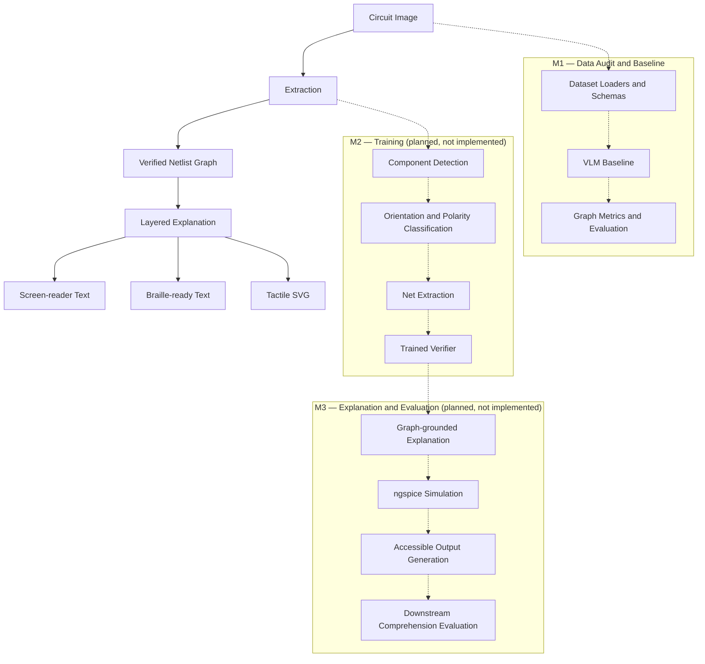

# Verified Circuit Access

**Making circuit diagrams accessible to blind students through verified, structured representations.**

## 1. Problem Statement

Circuit diagrams are widely used in high-school and undergraduate science and engineering education. However, these diagrams are primarily visual. Blind and visually impaired students may therefore be unable to independently identify electronic components, understand their connections, and follow the circuit's overall structure.

Existing text-to-speech and screen-reader tools cannot directly communicate the spatial and electrical relationships represented in a circuit diagram.

**Verified Circuit Access** aims to address this accessibility gap by converting circuit images into structured, verified representations that can eventually be communicated through screen readers, Braille displays, and tactile diagrams.

The central idea is to avoid presenting extracted circuit information as automatically correct. A verification layer is planned to identify potentially incorrect components and connections before explanations are generated.

## 2. Project Architecture

The planned system follows this pipeline:



### Milestones

**M1 — Data Audit and Baseline**

The current milestone establishes the dataset audit, common annotation and netlist schemas, dataset loaders, evaluation metrics, and a pluggable Vision-Language Model (VLM) baseline interface.

A VLM is a model capable of processing visual inputs and producing structured textual outputs.

**M2 — Training (planned, not implemented)**

- Component detection using a YOLO-family detector.
- Orientation, polarity, and crossing-versus-junction classification.
- Electrical net extraction.
- A trained verifier using gradient boosting and calibration.

**M3 — Explanation and Evaluation (planned, not implemented)**

- Layered explanations generated from verified circuit graphs.
- Numeric electrical facts grounded in ngspice simulation.
- Screen-reader text, Braille-ready output using liblouis, and tactile-printable SVG.
- Downstream comprehension evaluation.

## 3. M1 — Data Audit and Baseline

M1 establishes the data, representation, evaluation, and baseline infrastructure required for the circuit-understanding pipeline. Rather than immediately training models, this milestone defines how circuit diagrams and their electrical structures are represented, validated, and evaluated.

The work is divided into the following components.

### 1. Dataset Audit and Data Governance

Before using data for training or evaluation, we need to understand its source, format, licensing conditions, and intended use.

We created `DATASETS.md` to document six datasets:

- **Image2Net:** Component annotations and circuit netlists.
- **CGHD:** Additional circuit diagram and component data.
- **AMSnet 2.0:** Additional circuit understanding data.
- **Masala-CHAI:** Weakly labelled data, not intended for evaluation.
- **SINA:** Data relevant to wire and net extraction.
- **CircuitReason-1k:** Intended for downstream circuit reasoning and comprehension evaluation.

The audit records dataset sources, available formats, licensing information, intended use, and potential risks.

Datasets with unclear licensing or access conditions remain gated. No dataset files have been downloaded as part of the current M1 work.

**Purpose:** Establish a legally and technically suitable data foundation before model development.

### 2. Unified Annotation Schema

Different circuit datasets may use different annotation formats and component labels. A common representation is necessary to combine their information consistently.

We implemented Pydantic schemas in `src/vca/schemas/annotation.py` for:

- `ImageRecord`
- `CategoryRecord`
- `BoundingBox`
- `AnnotationRecord`
- `COCODataset`

A bounding box represents the location of a component in an image using its coordinates, width, and height. An annotation associates that location with a component category and image.

This provides a consistent COCO-style representation for component annotations.

**Purpose:** Establish a common annotation format that can be consumed by future component detection and evaluation modules.

### 3. Harmonized Component Taxonomy

Different datasets may use different names or identifiers for the same electrical component.

We created a taxonomy mapping that converts dataset-specific labels into canonical component categories.

Implemented in:

- `src/vca/schemas/taxonomy.py`
- `src/vca/schemas/taxonomy.json`

The taxonomy provides:

- Dataset-specific source-label mapping.
- Canonical component names and IDs.
- Case-insensitive lookup.
- An `unknown` fallback for unmapped labels.
- Preservation of original source labels.

The lookup function is:

`get_canonical(dataset_name, source_label)`

It returns the canonical category and its corresponding ID.

**Purpose:** Ensure that components from different datasets can be represented using a consistent vocabulary, which is important for model training and evaluation.

### 4. Netlist Schema — Structured Electrical Representation

A netlist is a structured representation of an electrical circuit. It describes the components in a circuit, their terminals, and the electrical connections between those terminals.

We implemented the Pydantic netlist schema in `src/vca/schemas/netlist.py`.

The main structures are:

- **Component:** Represents an electrical component, its ID, canonical category, and terminals.
- **Terminal:** Represents an individual connection point on a component.
- **Net:** Represents an electrical connection shared by multiple component terminals.
- **NetEndpoint:** Identifies a component terminal belonging to a net.
- **Netlist:** Contains the complete collection of components and nets.

The schema validates:

- Unique component IDs and net names.
- Unique terminal names within a component.
- Valid component and terminal references.
- At least two endpoints per net.
- No endpoint appearing in multiple nets.

The representation uses component-to-net relationships rather than treating a circuit as merely a collection of visual lines.

**Purpose:** Provide a common graph representation of electrical connectivity. This becomes the central structure used by evaluation, verification, and downstream circuit explanation.

### 5. Dataset Loaders and Format Conversion

Dataset annotations must be converted into our internal schemas before they can be used by downstream modules.

We implemented Image2Net loaders in `src/vca/data/image2net.py`.

The supported operations are:

| Loader | Functionality |
|---|---|
| `load_labelme_json()` | Reads Labelme component annotations and converts them into our annotation schema. |
| `load_yolo_obb()` | Converts YOLO oriented bounding-box polygon annotations into COCO-style bounding boxes. |
| `load_validation_netlist()` | Converts validation netlist data into our Pydantic Netlist representation. |

The loaders also validate input structure, coordinates, required fields, and source labels. Malformed input produces contextual errors rather than silently generating invalid annotations.

The CGHD loader in `src/vca/data/cghd.py` remains deliberately gated through `DatasetGatedError` because its licensing evidence is unresolved.

**Purpose:** Allow different dataset formats to be processed through a consistent internal data pipeline without requiring downstream modules to understand each dataset's original format.

### 6. Evaluation Metrics

To determine whether a predicted circuit is correct, we need metrics that evaluate both component detection and electrical connectivity.

The following metric families were developed in `src/vca/metrics/`.

**6.1 Netlist Edit Distance (NED)**

NED is intended to measure the structural difference between a predicted netlist and its ground-truth netlist using graph edit distance.

The formula described in the Image2Net paper is:

`NED = GED / (N_devices + N_nets + N_ports)`

The implementation remains deliberately gated by `NotImplementedError` because the paper's formula, official validation implementation, and empty-netlist behaviour have not yet been fully reconciled.

**6.2 Graph-Isomorphism Accuracy**

This metric checks whether predicted and ground-truth circuit graphs have equivalent structures.

The implementation constructs a bipartite incidence graph containing component nodes and net nodes. Component categories and terminal names are preserved, while arbitrary component IDs and net names are ignored.

**6.3 Component Precision and Recall**

These metrics evaluate whether the predicted components match the ground-truth annotations.

Matching uses Hungarian assignment, constrained by:

- Matching canonical component categories.
- A maximum component-centre distance of 10 pixels.

The 10-pixel threshold is provisional and has not been established as a validated performance threshold.

**6.4 Connection Precision and Recall**

These metrics compare electrical net endpoint sets, preserving component-terminal relationships.

The current component-correspondence implementation requires complete graph isomorphism. Consequently, connection precision and recall are not yet independent measures for non-isomorphic graphs. The evaluation pipeline leaves these values unavailable rather than reporting misleading results.

**Purpose:** Establish a framework for evaluating whether the system correctly identifies components and reconstructs electrical connectivity.

### 7. Vision-Language Model (VLM) Baseline Interface

A Vision-Language Model (VLM) can process circuit images and produce structured text or JSON representations.

M1 introduces a provider-independent interface for a future image-to-netlist baseline.

Implemented in `src/vca/baseline/`:

- `provider.py`: Defines the abstract VLM provider interface and environment-variable validation.
- `interface.py`: Handles predictions, Netlist JSON validation, retries, and logging.
- `errors.py`: Defines errors for exhausted retries, configuration failures, and missing approval.

The interface retries when a provider returns invalid JSON and raises `VLMExhaustedError` when all attempts fail.

A mock provider is used for testing without making real API calls.

No real VLM provider has been selected or integrated yet.

**Purpose:** Establish a replaceable baseline interface that can later be used to compare general-purpose VLM circuit extraction against the dedicated models developed in M2.

### 8. Evaluation Framework and Failure Overlays

The evaluation workflow is implemented in `src/vca/baseline/evaluation.py`.

It connects the image inputs, ground-truth netlists, VLM interface, graph comparison, and results storage.

The workflow:

1. Checks explicit dataset and VLM approval before accessing inputs.
2. Discovers supported circuit image files.
3. Finds the corresponding ground-truth netlist.
4. Sends the image to the configured VLM.
5. Validates the returned Netlist.
6. Compares predicted and ground-truth graph structures.
7. Records evaluation outcomes and failures.
8. Generates available visual overlays.
9. Saves metrics and experiment metadata.

The overlay utility in `overlay.py` draws ground-truth annotations and predicted boxes when prediction coordinates are available. Since the current VLM interface produces netlist-only predictions without bounding boxes, predicted localization is not fabricated. The current workflow therefore uses ground-truth overlays with an explanatory legend.

The current evaluation pipeline reports graph-isomorphism outcomes only. NED, component precision/recall, and connection precision/recall remain unavailable.

**Purpose:** Establish a reproducible evaluation workflow that can later support both the VLM baseline and the trained M2 pipeline.

### 9. Results Storage and Reproducibility

The results infrastructure is implemented in `src/vca/baseline/results.py`.

Each evaluation run stores:

- Metrics output.
- Configuration information.
- Git commit SHA.
- Random seed.
- Dataset and input provenance through the evaluation manifest.

The implementation avoids overwriting previous results when a run ID is reused.

Results are intended to be stored locally and are excluded from Git by default.

**Purpose:** Ensure that future model experiments can be reproduced, compared, and traced to the code and configuration that produced them.

### 10. Automated Testing and Code Quality

M1 includes unit tests and property-based tests to validate the schemas, loaders, metrics, and VLM interface.

The project uses:

- **pytest:** Automated unit and integration testing.
- **Hypothesis:** Property-based testing across generated valid inputs.
- **Ruff:** Python linting and code-quality checks.

The tests cover schema validation, serialization, taxonomy lookup, annotation conversion, metric invariants, and VLM retry behaviour.

Latest reported verification:

- **107 tests passed.**
- **Ruff:** All checks passed.

### M1 Outcome

M1 establishes the foundation on which the remaining milestones depend:

1. A common representation for component annotations.
2. A harmonized component taxonomy.
3. A structured electrical netlist schema.
4. Dataset loaders for supported annotation formats.
5. An initial evaluation metric framework.
6. A provider-independent VLM baseline interface.
7. An evaluation and results-storage workflow.
8. Automated tests and reproducibility safeguards.

M1 does not yet provide a trained circuit detector, a real VLM evaluation, or accessible circuit explanations. Those capabilities belong to subsequent milestones.

**In relation to the complete project:** M1 defines how circuit information is represented and evaluated. M2 will build the models that extract and verify this information from images. M3 will use the verified circuit representation to generate explanations and accessible outputs for blind students.

## 4. Technology Stack

- **Python 3.11** — primary implementation language.
- **Pydantic** — structured data validation.
- **NetworkX** — graph construction and isomorphism.
- **SciPy** — Hungarian assignment for component matching.
- **Pillow** — evaluation overlays.
- **pytest** — automated testing.
- **Hypothesis** — property-based testing.
- **Ruff** — linting.
- **uv** — dependency and environment management.

## 5. Setup and Reproduction

### Prerequisites

- Python 3.11
- pip
- Git
- Linux, macOS, or another compatible Python environment

### Step 1: Clone the repository

```bash
git clone <repository-url>
cd verified-circuit-access
```

### Step 2: Create and activate a virtual environment

```bash
python3.11 -m venv .venv
source .venv/bin/activate
```

On Windows:

```powershell
.venv\Scripts\activate
```

### Step 3: Install the project and development dependencies

```bash
pip install -e ".[dev]"
```

The development dependencies include pytest, Hypothesis, and Ruff.

Alternatively, using the existing uv lockfile:

```bash
uv sync --locked
```

### Step 4: Configure environment variables if required

Copy the example environment file only when configuring a provider that needs credentials:

```bash
cp .env.example .env
```

The current `.env.example` contains comments only. No real provider or API credential has been configured.

**Never commit real API keys, passwords, or other credentials to Git.** Store credentials in environment variables and keep `.env` out of version control.

### Step 5: Dataset preparation and approval

Before using any dataset, review `DATASETS.md` and resolve its licensing and access requirements.

The current `make data` target is a placeholder. It prints a licensing reminder and exits with an error. An interactive dataset approval and download workflow has not yet been implemented.

No dataset files are included in the repository.

### Step 6: Evaluation

The intended command is:

```bash
make eval
```

However, this target is currently a placeholder and exits without running an evaluation.

The Python evaluation framework requires separate explicit dataset and VLM approvals through `data_approved=True` and `vlm_approved=True`. These approvals do not override unresolved dataset licensing restrictions.

No real VLM API calls or full evaluation runs have been performed.

**API cost:** A reliable per-run estimate is not currently available because no provider or model has been selected and no full evaluation run is configured. Once selected, the estimated cost can be calculated using the provider's current input/output pricing, image-token usage, expected retries, and number of evaluation circuits. No API cost is claimed for the current implementation.

### Step 7: Demo

```bash
make demo
```

The demo target is currently a placeholder and exits without launching an application.

### Step 8: Run tests and lint

Run the full test suite:

```bash
pytest
```

Run lint checks:

```bash
ruff check .
```

## 6. Dataset Approval Status

Dataset approval is tracked separately from implementation. No dataset files have been downloaded or included in the repository.

| Dataset | Status | Reason |
|---|---|---|
| Image2Net (`ci2n_datasets`) | Pending approval | Repository code and material have an Apache-2.0 license, but the original-source data licensing caveat requires explicit approval. |
| CGHD | Pending approval | Conflicting license information across sources; the actual Zenodo release license remains unresolved. |
| AMSnet 2.0 | Pending approval | License and confirmed public access or distribution are unverified. |
| Masala-CHAI | Pending approval | License and distribution source are unclear. Weak labels only; never for evaluation. |
| SINA | Pending approval | Explicit license and dataset distribution source remain unverified. |
| CircuitReason-1k | Pending approval | No repository license; benchmark images are not bundled and depend on source materials with appropriate usage rights. |

Refer to `DATASETS.md` for the detailed source, license, format, size, intended use, and risk audit.

## 7. Evaluation Metrics

The following metrics are part of the M1 evaluation design.

| Metric | Value range | Passing threshold | Current result |
|---|---|---|---|
| Normalized Edit Distance (NED) | not run | not run | not run |
| Graph-isomorphism accuracy | not run | not run | not run |
| Component precision | not run | not run | not run |
| Component recall | not run | not run | not run |
| Connection precision | not run | not run | not run |
| Connection recall | not run | not run | not run |

Numeric cells are marked `not run` because no real-data evaluation results have been produced. Passing thresholds have not yet been established.

### Metric definitions

- **Normalized Edit Distance:** Measures the normalized graph-edit difference between a predicted and ground-truth circuit netlist. Its implementation remains gated pending verification of the reference formula and edge cases.
- **Graph-isomorphism accuracy:** Measures whether predicted and ground-truth circuit graphs have equivalent topology, considering canonical component categories and terminal connections.
- **Component precision:** Measures the proportion of predicted components that match ground-truth components.
- **Component recall:** Measures the proportion of ground-truth components successfully matched.
- **Connection precision:** Measures the proportion of predicted connections that match ground-truth connections.
- **Connection recall:** Measures the proportion of ground-truth connections successfully recovered.

Component matching currently uses Hungarian assignment, canonical categories, and a provisional centre-distance threshold of 10 pixels. This is a matching parameter, not an experimentally established passing threshold.

Connection matching currently depends on full graph isomorphism for component correspondence. Consequently, it cannot independently quantify connection errors when the graphs are not isomorphic.

## 8. Project Structure

```text
verified-circuit-access/
├── DATASETS.md
├── PLAN.md
├── README.md
├── Makefile
├── pyproject.toml
├── uv.lock
├── .env.example
├── src/
│   └── vca/
│       ├── schemas/
│       ├── data/
│       ├── metrics/
│       ├── baseline/
│       ├── detect/
│       ├── classify/
│       ├── netting/
│       ├── verify/
│       ├── explain/
│       └── outputs/
└── tests/
    ├── schemas/
    ├── data/
    ├── metrics/
    └── baseline/
```

Dataset files and generated evaluation results are excluded from version control according to `.gitignore`.

## 9. Reproducibility and Project Rules

- Use Python 3.11 and pinned dependencies.
- Use real datasets only after explicit approval.
- Never generate synthetic training or evaluation images or labels.
- Do not commit dataset images, copyrighted textbook material, API credentials, or generated evaluation results.
- Record configuration, random seed, and Git commit hash for actual evaluation runs.
- Report uncomputed metrics as `not run`.
- Keep M2 and M3 functionality separate from the M1 implementation until those milestones are approved.

## 10. Project Status

**Current milestone: M1 — Data Audit and Baseline**

The repository contains the M1 schemas, loaders, metrics, VLM interface, evaluation framework, and automated tests.

Dataset usage and real VLM evaluation remain subject to explicit approval. NED computation remains intentionally gated. The M2 training pipeline and M3 explanation and accessibility outputs are planned but not implemented.

See `PLAN.md` for the complete milestone plan and `DATASETS.md` for dataset approval details.
